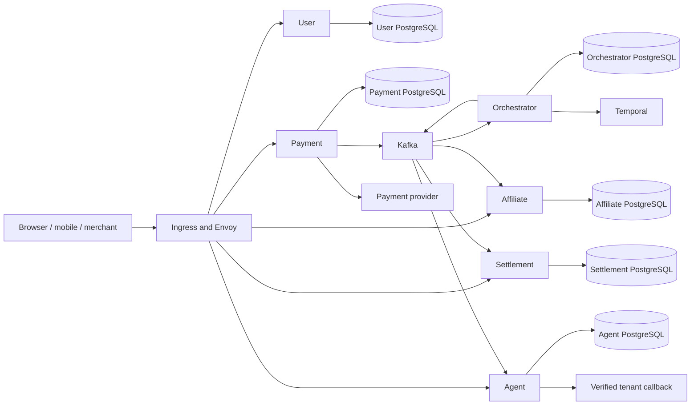
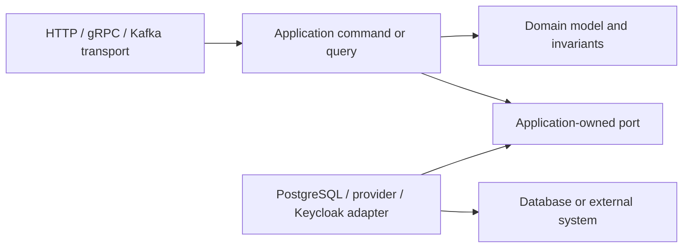
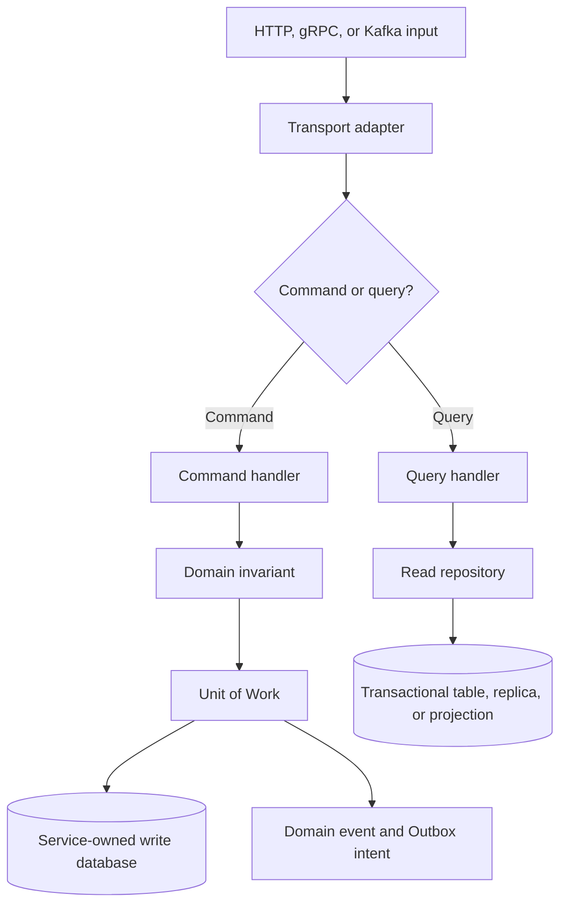
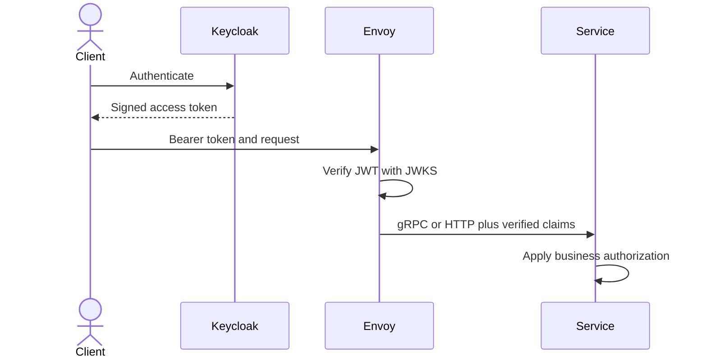
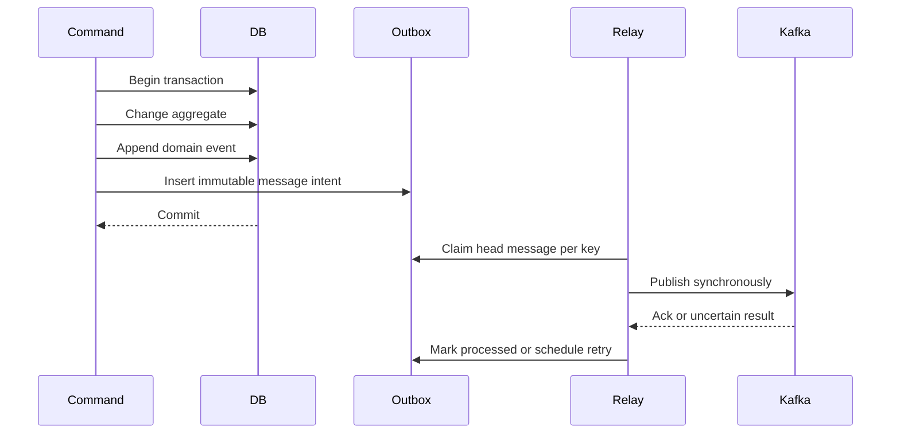
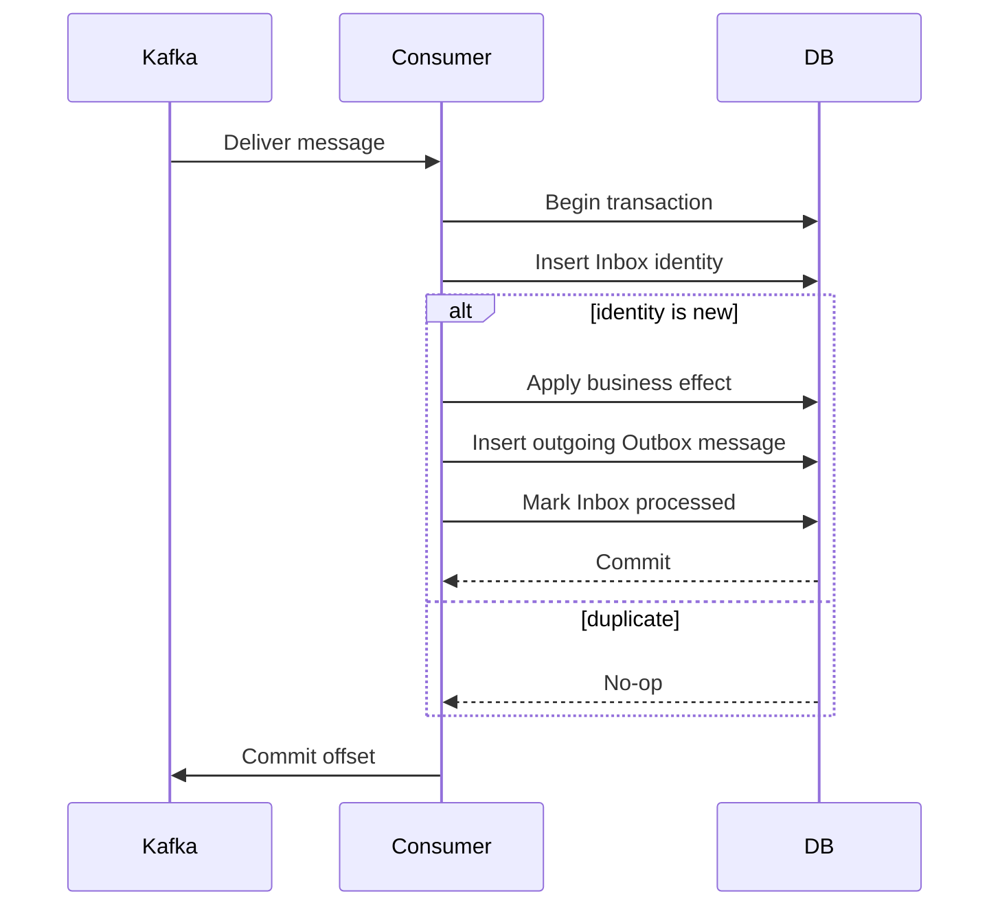
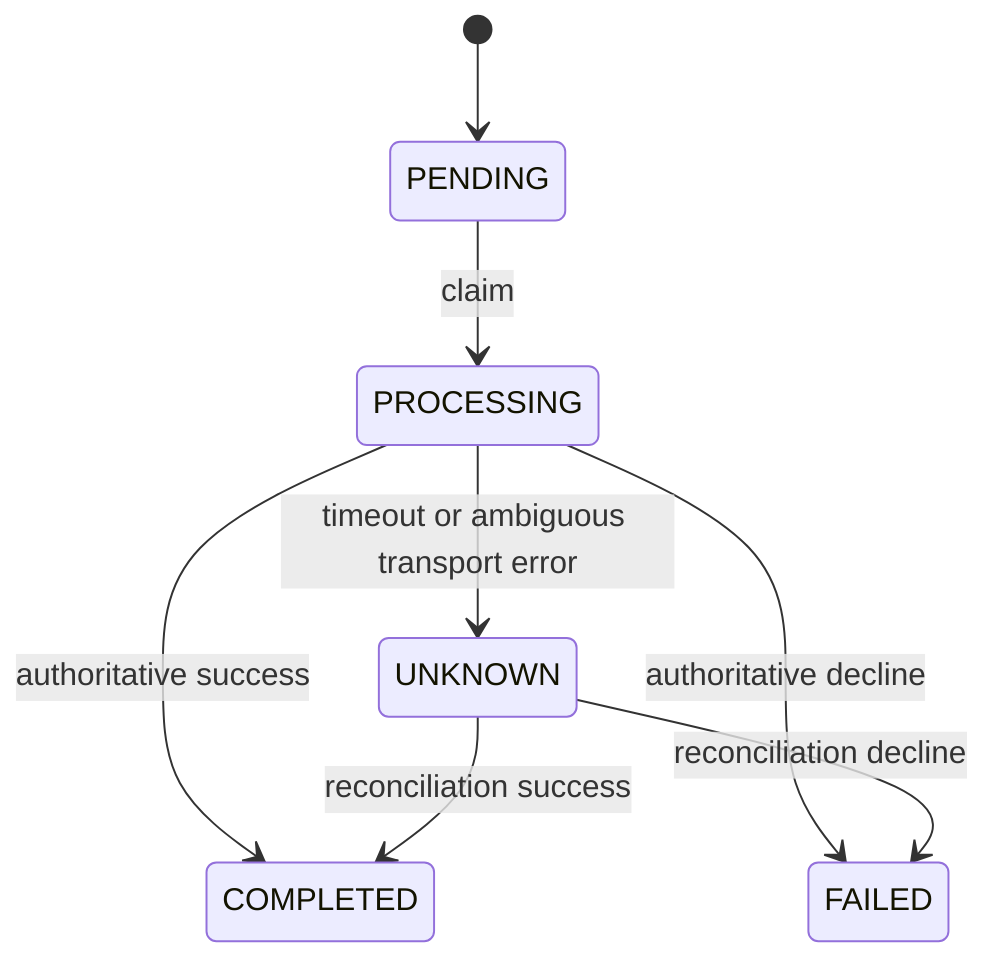
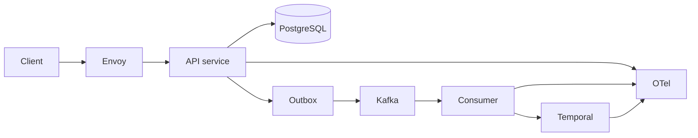
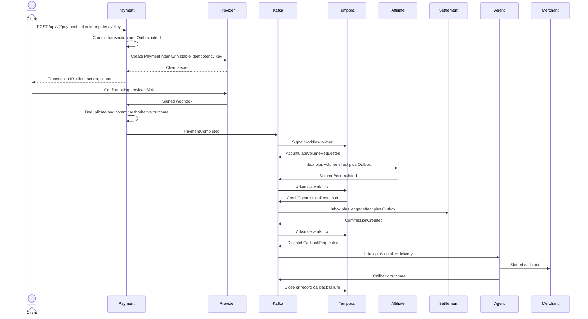

# CQRS and Service Integration Engineering Handbook

> Source snapshot: 2026-08-14
>
> This handbook explains the techniques used by Master Go CQRS and the
> production architecture being implemented. It is a learning guide, not a
> claim that a local checkout has passed production load, failover, or disaster
> recovery testing.

## 1. How to read this handbook

Every technique has two independent labels:

| Label | Meaning |
| --- | --- |
| **Implemented** | The behavior exists in the current source tree. |
| **Partially implemented** | A useful primitive exists, but one or more production invariants are missing. |
| **Target architecture** | The design is approved but is not fully implemented in this repository. |
| **Source evidence** | A link points to executable source or configuration. |
| **Test evidence** | A focused automated test exercises the behavior. |
| **Migration evidence** | An additive or reversible database migration exists. |
| **Production runtime not verified** | Local source and tests do not prove the production topology or SLO. |

Suggested learning paths:

1. **CQRS and clean boundaries:** sections 3 and 4.
2. **Reliable distributed processing:** sections 5 through 8.
3. **Payments and external systems:** sections 9 through 11.
4. **Scaling and operations:** sections 12 through 15.

The detailed distributed-transaction invariants live in
[Distributed Transactions](distributed-transactions.md). Deployment profiles
and launch gates live in [Production Operations](../operations/production.md).
Incident response lives in [Incident Runbooks](../operations/runbooks.md).

## 2. System context

The repository contains six independently deployable services:

| Service | Primary responsibility |
| --- | --- |
| User | Identity synchronization, authentication support, and access-control checks. |
| Payment | Payment transaction lifecycle and payment-provider integration. |
| Affiliate | Referral graph, accumulated qualification volume, and rank. |
| Settlement | Balance, commission ledger, credit limits, and withdrawals. |
| Agent | Tenant/agent configuration, API keys, audit logs, and callback delivery. |
| Orchestrator | Durable multi-service payment process using Temporal or the fallback PostgreSQL Saga. |



### Core ownership rules

- A service owns its schema and migration history.
- A service never imports another service's internal implementation.
- Cross-service state moves through an explicit gRPC or Kafka contract.
- `contracts/` owns public wire definitions; `internal/platform/` owns reusable
  infrastructure, not business policy.
- No service reads another service's database or performs a cross-service SQL
  join.

**Implemented — source and test evidence:**
[architecture boundary test](../../internal/architecture/architecture_test.go),
[migration ownership guide](../operations/migrations.md).

## 3. Clean Architecture inside a service

Each service follows the same inward dependency direction:



### Problem

Infrastructure changes frequently. Business rules should not be rewritten when
the project moves from a simulator to Stripe, changes Kafka settings, or replaces
a persistence library.

### Decision

- **Domain:** entities, value objects, state transitions, and domain errors.
- **Application:** use cases and transaction coordination.
- **Application ports:** interfaces required by a use case.
- **Adapters:** PostgreSQL, Kafka, provider, Keycloak, or HTTP implementations of
  those ports.
- **Transport:** input validation and conversion between wire DTOs and
  application input.
- **Composition root:** Uber Fx wiring in each service's `module.go`.

### Invariants

- Domain code does not import HTTP, gRPC, Kafka, GORM, or configuration packages.
- Application code does not import an adapter or transport package.
- Transport does not call a persistence adapter directly.
- External clients are represented by application-owned interfaces.

### Evidence and limitations

**Implemented — source evidence:**
[Payment composition root](../../services/payment/module.go),
[Payment ports](../../services/payment/internal/application/port/port.go), and
[architecture boundary test](../../internal/architecture/architecture_test.go).

**Partially implemented:** a small number of application handlers still expose
GORM-oriented transaction details. The production target is to keep raw GORM
types inside persistence adapters while preserving short, explicit Units of Work.

## 4. CQRS request paths

CQRS separates the intent to change state from the intent to read state. It does
not automatically require two databases.



### Commands

A command has business intent, may change an aggregate, and owns the transaction
that commits state plus outgoing-message intent. Retrying a command is safe only
when its idempotency invariant is defined.

### Queries

A query is read-only. It must not publish a message, call a payment provider, or
hide a state transition. Read repositories may later route to replicas or
projections without changing command behavior.

### Logical versus physical CQRS

**Implemented:** commands and queries are separate application handlers.

**Target architecture:** use read replicas for high-volume simple reads and add
asynchronous projections only when a measured query cannot meet its SLO from the
service-owned transactional model. A shared operational reporting database is
not introduced as a hidden coupling mechanism.

### Failure checks

- A query that sends Kafka messages violates CQRS.
- A command that writes business state and publishes Kafka directly has a
  dual-write gap.
- A handler that imports another service's repository violates ownership.

### Durable User-to-Keycloak synchronization technique

1. **Problem.** A paginated Keycloak synchronization can take longer than a
   database transaction or Kafka handler. Calling Keycloak while holding either
   lock makes restart recovery and horizontal scaling unsafe.
2. **Design decision.** Persist a `user_sync_jobs` intent and cursor, then let a
   separately leased worker perform one bounded page outside the transaction.
3. **How it works.** A consumer atomically checkpoints the source event and
   enqueues a deduplicated job. Workers claim with `FOR UPDATE SKIP LOCKED`, call
   Keycloak without a database transaction, then advance the cursor and local
   event intents in a short fenced transaction.
4. **Required invariants.** Deduplication key identifies one logical job; lease
   token fences stale workers; cursor never moves backwards; a page result and
   its emitted events commit together; retry and terminal state are durable.
5. **Source-code map.** See [job repository](../../services/user/internal/adapter/persistence/postgres/sync_job_repository.go),
   [job runner](../../services/user/internal/application/command/sync_jobs.go),
   [worker lifecycle](../../services/user/internal/transport/consumer/sync_job_worker.go),
   and [migration](../../services/user/migrations/000008_create_user_sync_jobs.up.sql).
6. **Failure scenarios.** A crash before page commit repeats the page safely; a
   crash after commit resumes from the new cursor; an expired lease is reclaimed;
   a stale worker cannot advance after a new lease token is issued.
7. **Trade-offs.** Synchronization becomes eventually consistent and needs job
   operations/alerts, but it removes long transactions and enables safe scale-out.
8. **Current status.** **Implemented** with repository, command, worker, migration,
   and focused tests.
9. **Target status.** Production queue-age dashboards, alert thresholds, and a
   live Keycloak restart/latency drill remain **Production runtime not verified**.
10. **Verification steps.** Run the User repository/worker tests, kill a worker
    between provider call and cursor commit in staging, confirm lease recovery,
    and verify that each resulting user event has one business effect.

## 5. Synchronous communication and the trust boundary

### Current request path



Envoy performs REST-to-gRPC transcoding for annotated Protobuf methods. Direct
HTTP routes remain appropriate for payloads that must be byte-for-byte intact,
such as a signed payment-provider webhook.

### Authentication is not authorization

- **Authentication:** establish who issued the request.
- **Route authorization:** decide whether that identity may call a route.
- **Business authorization:** decide whether the identity owns the specific
  tenant resource and may perform the requested state transition.
- **Workload identity:** authenticate one service or worker to another.

### Evidence and gap

**Implemented — source and test evidence:** Envoy removes a caller-supplied
claim payload before JWT processing, and every public service independently
validates the bearer token's RS256 signature, issuer, audience, expiry, and JWKS
key ID. Forwarded-payload fallback is available only when
`AUTH_JWT_REQUIRED=false` for local compatibility. See the
[JWT verifier](../../internal/platform/security/gatewayauth/jwt.go),
[verification tests](../../internal/platform/security/gatewayauth/jwt_test.go),
[HTTP boundary](../../internal/platform/security/gatewayauth/http.go),
[gRPC boundary](../../internal/platform/security/gatewayauth/grpc.go), and
[Envoy configuration](../../dockers/envoy/envoy.yaml).

**Partially implemented:** agent configuration and callback resources enforce
claim-derived tenant/agent ownership. Public payment, affiliate, and settlement
handlers also derive the agent identity from verified claims and reject a
conflicting request field. Complete tenant columns, deterministic legacy-row
backfills, user/orchestration resource ownership, and Istio mTLS workload
identity remain production launch gates. A valid token alone is not evidence
that every legacy row has an unambiguous owner.

### Synchronous-call policy

- Set an end-to-end deadline and allocate smaller downstream budgets.
- Retry only idempotent operations and only for explicitly retryable failures.
- Do not stack retries at every layer.
- Use a circuit breaker or concurrency limiter for a failing dependency.
- Never hold a database transaction open while waiting for a slow external API.

## 6. Kafka contracts and delivery semantics

Kafka is the asynchronous integration backbone. It provides durable transport;
it does not make a PostgreSQL business effect exactly once.

### Message kinds

- **Fact/event:** something already happened. It uses an immutable event UUID or
  aggregate identity plus aggregate version.
- **Command message:** a request for another service to perform one logical step.
  Its identity is deterministic from transaction, step, and orchestration
  generation.
- **Dead letter:** evidence that a specific consumer could not process a source
  record.

### Delivery invariant

```text
atomic local commit
+ at-least-once publish and delivery
+ consumer Inbox
+ business uniqueness constraint
= one business effect
```

### Ordering

The payment process uses `transaction_id` as Kafka key. This preserves ordering
inside one partition for a payment while allowing unrelated transactions to run
in parallel. Global ordering is neither required nor desirable.

### Contract evolution

**Implemented:** Event Envelope v2 is a typed Protobuf contract. Its Confluent
wire codec registers the envelope and Well-Known-Type references, configures
`BACKWARD_TRANSITIVE`, binds schema IDs to `<topic>-value`, caches bounded
lookups, rejects an incompatible schema as permanent, and fails a producer
closed while leaving its Outbox row retryable when Registry access fails.
JSON remains an explicit local/compatibility serialization mode.

**Partially implemented:** the production Helm profile selects Protobuf, but
dedicated `.v2` business topics and a live Kafka/Schema Registry compatibility
run have not been verified. Legacy byte payloads are temporarily wrapped in a
typed `BytesValue`; service-native Protobuf payload migration is still open.

Source evidence:
[Kafka envelope](../../internal/platform/kafka/message.go),
[Event Envelope v2 contract](../../contracts/proto/event_envelope_v2.proto),
[Schema Registry client](../../internal/platform/kafka/schema_registry.go),
[codec tests](../../internal/platform/kafka/codec_test.go),
[producer](../../internal/platform/kafka/producer.go), and
[consumer](../../internal/platform/kafka/consumer.go).

## 7. Transactional Outbox and EventStore relay

### Problem: the dual-write gap

Writing PostgreSQL and Kafka separately creates two unrecoverable windows:

1. Database commit succeeds but Kafka publish fails.
2. Kafka publish succeeds but database commit fails.

### Decision

Write business state, the domain event, and an Outbox row in the same PostgreSQL
transaction. A separate relay publishes the committed Outbox row.



### Hardened polling behavior

**Implemented — source and test evidence:**

- multi-worker claims with `FOR UPDATE SKIP LOCKED`;
- a lease owner and stale-lease recovery;
- fencing when marking processed or retrying;
- bounded exponential retry;
- terminal `DEAD` quarantine;
- head-of-line ordering per message key;
- immutable duplicate enqueue.

See [Outbox repository](../../internal/platform/outbox/repository.go),
[publisher](../../internal/platform/outbox/publisher.go), and
[tests](../../internal/platform/outbox/repository_test.go).

### Immutable fact identity

A recurring fact must not use only `aggregate_id:step`: a second legitimate fact
would collide with the first Outbox row and `ON CONFLICT DO NOTHING` would hide
it. Facts use aggregate version or an event UUID; deterministic step identity is
reserved for commands.

### Polling versus CDC

Polling is suitable for local development, moderate traffic, and fallback.
Debezium Outbox Event Router is the production target when polling creates
measurable database amplification or cannot meet lag SLO. Only one relay owns an
Outbox at a time; CDC and polling must not publish the same rows concurrently.

## 8. Transactional Inbox, retries, and DLQ



If the process dies after the database commit but before offset commit, Kafka
redelivers. The Inbox prevents a second business effect.

### Three layers of duplicate protection

1. Inbox identity prevents the same logical consumer from applying one message
   twice.
2. A business unique constraint prevents duplicate ledger or relationship rows.
3. State-transition checks reject a stale or conflicting effect.

**Implemented — migration evidence:** Inbox identity is scoped by
`(consumer_name, message_id)` in service-owned migrations.

### Retry policy

- Invalid envelope or impossible contract: permanent, send to DLQ.
- Dependency timeout or temporary unavailability: retryable.
- Retry budget exhausted: DLQ or durable manual-review state.
- Source offset commits only after successful processing or successful DLQ
  publication.

**Partially implemented:** the general Kafka consumer still uses bounded
in-process retry before DLQ. Delay-tier retry topics remain the target for high
throughput so one poison record does not sleep and block a partition. Callback
delivery is the exception: the Kafka handler commits an Inbox plus durable job
and returns; a separate leased worker performs network I/O and schedules fixed
delays without holding a consumer or database lock.

## 9. Saga and Temporal orchestration

The payment process is ordered and long-running:

```text
payment confirmed
→ accumulate affiliate volume
→ credit settlement commission
→ dispatch callback
→ close workflow
```

### Why orchestration

Pure choreography makes deadlines, retries, audit state, and sequence changes
implicit across consumers. A central process definition makes those rules
visible while each service still owns its local transaction.

### Why not distributed 2PC

Kafka, a payment provider, and a tenant callback cannot participate in one
portable database transaction. Holding distributed locks for a long process
would reduce availability. Saga uses local commits and explicit recovery or
compensation.

### Compensation is not physical rollback

A credited ledger row is not deleted. A future reversal is a new, auditable
ledger entry referencing the original. Callback failure does not reverse money;
it produces a callback-specific terminal/retry state.

### Temporal and fallback Saga

**Implemented:** both a PostgreSQL-backed Saga and Temporal workflow adapters
use a shared payment process definition. Temporal workflow versioning and replay
tests exist.

**Target architecture:** Temporal owns all new production workflows. PostgreSQL
Saga remains a drained fallback and learning engine.

Each transaction carries immutable ownership:

```text
orchestration_owner = saga:v1 | temporal:v2
orchestration_generation = positive integer
```

An existing workflow never changes owner. A rollback routes only newly created
transactions to a new generation. Separate consumer groups are necessary but
not sufficient: routing must also prevent the inactive engine from replaying
retained history and emitting commands.

Source evidence:
[shared process definition](../../services/orchestrator/internal/payment/definition.go),
[Saga runtime](../../services/orchestrator/internal/payment/saga/runtime.go), and
[Temporal workflow](../../services/orchestrator/internal/payment/temporal/workflow.go).

## 10. Money and financial correctness

Binary floating point cannot exactly represent many decimal monetary values.
Financial domain and v2 integration contracts therefore use integer minor units:

```text
Money {
  amount_minor: int64
  currency: string
  exponent: int32
}
```

Examples:

| Human amount | Currency exponent | Minor units |
| --- | ---: | ---: |
| USD 100.50 | 2 | 10050 |
| JPY 100 | 0 | 100 |
| VND 250000 | 0 | 250000 |

### Invariants

- Currency is normalized and must be explicitly supported.
- Exponent must match currency metadata.
- Addition and subtraction require the same currency/exponent.
- Arithmetic checks overflow.
- Commission calculation uses deterministic integer rounding.
- Legacy float conversion exists only at a compatibility boundary and rejects
  unsupported precision, NaN, infinity, and overflow.

**Implemented — source and test evidence:**
[shared Money value object](../../internal/shared/money/money.go) and
[Money tests](../../internal/shared/money/money_test.go). Payment v2, payment
events, orchestration, affiliate volume, settlement commission, and callback
payloads prefer the minor-unit contract and perform arithmetic with checked
integers. See [integration Money contract](../../contracts/messagebus/money.go),
[affiliate accumulation](../../services/affiliate/internal/application/command/accumulate_volume.go),
and [settlement commission](../../services/settlement/internal/application/command/calculate_and_credit_commission.go).

**Partially implemented:** legacy v1 APIs, Protobuf messages, return signatures,
and table columns retain decimal/double compatibility fields during
expand-and-contract migration. V2 arithmetic is authoritative, but removal of
compatibility fields requires the traffic window and production backfill
evidence.

### Zero-downtime data migration

1. Add nullable `amount_minor`, `currency`, and `exponent` columns.
2. Deploy dual-write code.
3. Backfill in bounded, resumable batches.
4. Quarantine a row that cannot be represented exactly.
5. Switch reads and projections to v2.
6. Stop legacy writes.
7. Remove old columns after the compatibility window and 30 consecutive days
   without v1 traffic.

## 11. Payment provider and uncertain outcomes

### Provider-neutral boundary

Application code depends on intent-oriented operations rather than Stripe SDK
types:

```text
CreateIntent
RetrieveIntent
CancelIntent
ParseWebhook
```

Stripe is the first production adapter. The simulator remains local/test-only.

**Implemented — source, test, and migration evidence:** the payment application
owns the provider port; the Stripe adapter creates, retrieves, and cancels
PaymentIntents and validates signed webhook bytes with timestamp tolerance.
Provider-event deduplication and Money/provider columns are additive migrations.
See [provider port](../../services/payment/internal/application/port/port.go),
[Stripe adapter](../../services/payment/internal/adapter/gateway/stripe),
[Payment v2 handler](../../services/payment/internal/application/command/create_payment_v2.go),
and [payment migrations](../../services/payment/migrations).

**Production runtime not verified:** no real Stripe account, webhook delivery,
or reconciliation soak was exercised by the repository test suite.

### Client-side tokenization

The backend creates a PaymentIntent and returns a client secret. Stripe Elements
or the platform SDK collects and tokenizes card data. PAN and CVV never enter
this backend, PostgreSQL, Kafka, Temporal history, logs, or traces.

### Timeout is not decline

A provider timeout cannot prove that a charge failed. The local payment enters
`UNKNOWN`; reconciliation retrieves the existing intent using the same logical
idempotency identity. It never blindly creates another charge.



### Idempotency layers

- API key plus canonical request fingerprint.
- Stable provider idempotency key for one logical transaction.
- Compare-and-swap processing claim.
- Webhook event deduplication.
- Event/Outbox/Inbox identity downstream.

## 12. Tenant identity and business authorization

The target verified identity contains subject, tenant ID, roles, scopes, issuer,
and audience. Initial roles are `tenant_member`, `tenant_admin`,
`finance_operator`, and `platform_operator`.

### Ownership rule

The authenticated tenant comes from a signed claim. A client-provided `agent_id`
or `tenant_id` is input to compare against ownership, never the source of truth.

```text
verified tenant from token
→ load resource using (tenant_id, resource_id)
→ enforce role/scope and state invariant
→ execute command or query
```

### Workload identity

User identity answers “which person or tenant?”. mTLS/SPIFFE identity answers
“which deployed workload?”. Both are needed. Kafka ACLs and database roles are
assigned per service, not through a shared super-user.

**Implemented:** Keycloak development realm mappers emit tenant and agent claims;
service-boundary JWT verification is fail-closed in the production Helm profile;
agent, payment, affiliate, and settlement public handlers derive agent ownership
from verified claims; and the chart renders a default-deny NetworkPolicy with
explicit DNS, internal, and declared egress. Negative handler tests cover
conflicting client-supplied ownership identifiers.

**Partially implemented:** complete ownership columns and deterministic
backfills for payment, affiliate, settlement, user, and orchestration records,
Istio mTLS, workload authorization, and production NetworkPolicy validation
remain launch gates.

## 13. Callback delivery and egress security

A callback URL is an outbound network capability. Treating arbitrary user input
as a URL creates SSRF and data-exfiltration risk.

### Registration

1. Tenant submits an HTTPS endpoint.
2. Service canonicalizes the origin and checks the hostname against the
   production egress allowlist. The allowlist is not ownership proof.
3. DNS and resolved addresses are checked against forbidden ranges.
4. Tenant proves control through a challenge.
5. Endpoint becomes active only after verification.

### Dispatch

- Re-resolve and revalidate the destination at connect time.
- Reject loopback, link-local, private, metadata, multicast, and reserved ranges.
- Disable redirects or restrict them to the same verified origin.
- Use controlled egress proxy/NAT in production.
- Sign the exact body with a versioned HMAC key.
- Include event ID, timestamp, tenant, transaction, digest, and key version.
- Rotate keys with an overlap window.
- Retry at 30 seconds, 2 minutes, 10 minutes, 1 hour, and 6 hours.
- Exhausted deliveries enter callback-specific DLQ and audited manual replay.

Callback failure never rolls back a completed payment or commission.

**Implemented — source, test, and migration evidence:** endpoint normalization,
HTTPS production enforcement, public-address filtering, connect-time DNS
revalidation, redirect denial, versioned HMAC signing, one-time ownership proof,
durable scheduling, leases with fencing, the required retry sequence, callback
DLQ, and audited `platform_operator` replay exist in the Agent service. See
[callback security adapter](../../services/agent/internal/adapter/gateway/callback/security.go),
[durable repository](../../services/agent/internal/adapter/persistence/postgres/callback_delivery_repository.go),
[delivery worker](../../services/agent/internal/transport/consumer/callback_worker.go),
[ownership verification tests](../../services/agent/internal/application/command/callback_verification_test.go),
[delivery tests](../../services/agent/internal/transport/consumer/callback_command_test.go),
and [durable callback migration](../../services/agent/migrations/000008_add_durable_callback_delivery.up.sql).

**Partially implemented:** HMAC key overlap is configuration-driven rather than
an automated rotation controller, and a managed egress proxy/NAT plus live DNS
rebinding tests are production-environment responsibilities not verified here.

## 14. Observability and operational scaling

### Trace continuity



Propagate W3C trace context plus correlation and causation IDs. Transaction and
message IDs belong in structured logs and traces, not high-cardinality metric
labels.

### Scale dimensions

- HTTP APIs scale on concurrency, latency, and CPU.
- Kafka workers scale on consumer lag and partition count.
- Temporal workers scale on task-queue schedule-to-start latency.
- Outbox workers scale on backlog and oldest pending age.
- PostgreSQL uses connection budgets and PgBouncer; replicas serve approved read
  workloads.

### Production targets

- 500 payments/second sustained, 2,000/second peak.
- API p95 below 200 ms.
- Asynchronous processing p95 below 5 seconds.
- 99.9% availability.
- RPO 5 minutes and RTO 30 minutes.
- Backlog drains within 10 minutes after peak traffic.

**Production runtime not verified:** these are acceptance targets. They require a
24-hour soak, a 60-minute peak test, broker/database/AZ failure tests, and a
restore drill on the managed topology.

## 15. End-to-end payment walkthrough



### Crash reasoning

| Crash point | Durable recovery |
| --- | --- |
| Before local commit | No state or message is visible; retry the idempotent command. |
| After local commit, before publish | Outbox remains pending and publishes later. |
| Publish succeeded, ack was lost | Outbox may publish again; Inbox/business uniqueness deduplicate. |
| Consumer DB committed, offset not committed | Kafka redelivers; Inbox returns a no-op. |
| Provider accepted, response timed out | Payment is `UNKNOWN`; reconciliation retrieves the same intent. |
| Temporal worker terminated | Workflow replays from durable history. |
| Callback timed out | Durable callback retry uses the same event identity and signature contract. |

## 16. Failure matrix

| Failure | Expected classification | Required behavior |
| --- | --- | --- |
| Invalid JSON or Protobuf | Permanent | DLQ with source coordinates and payload digest. |
| Unsupported schema | Permanent | DLQ; never guess a payload interpretation. |
| Kafka or database unavailable | Retryable | Bounded retry without losing the durable intent. |
| Duplicate event | Semantic duplicate | No second business effect. |
| Event arrives too early | Retryable or buffered | Preserve causal order; never fabricate missing state. |
| Event conflicts with financial progress | Manual review | Preserve history and alert an operator. |
| Provider timeout | Uncertain | Enter `UNKNOWN` and reconcile. |
| Provider decline | Definitive | Enter `FAILED`; do not run downstream financial steps. |
| Callback 4xx | Usually definitive | Record failure; do not reverse financial state. |
| Callback 5xx or timeout | Retryable | Use durable delayed retry, then callback DLQ. |
| Outbox retry exhausted | Causal quarantine | `DEAD` blocks later messages for the same key. |

## 17. Verification checklist

### Code and contracts

- `go test ./... -count=1`
- focused `go test -race` for platform, payment, and orchestration packages
- `go vet ./...`
- architecture dependency test
- generated Protobuf/OpenAPI drift check
- Schema Registry compatibility check for v2 contracts
- migration `up → down → up` for every service
- `git diff --check`

### Correctness scenarios

- duplicate API request with matching and conflicting fingerprints;
- duplicate Kafka delivery and offset-commit failure;
- recurring aggregate facts;
- out-of-order and conflicting workflow events;
- provider accepted-but-timeout and late webhook;
- callback SSRF, redirect escape, DNS rebinding, signature replay, and key rotation;
- tenant token attempting to access another tenant's resource;
- no PAN, CVV, token, or secret in logs, Kafka, traces, or Temporal history.

### Production evidence

- 24-hour sustained-load soak;
- 60-minute peak-load run;
- Kafka broker, PostgreSQL writer, worker, and availability-zone failure;
- Schema Registry and observability outage;
- point-in-time restore meeting RPO/RTO;
- Temporal replay and version-ramp rollback;
- no lost event, duplicate business effect, or monetary drift.

## 18. Technique-to-source map

| Technique | Current status | Primary evidence |
| --- | --- | --- |
| Clean Architecture boundaries | Implemented | [Architecture test](../../internal/architecture/architecture_test.go) |
| Logical CQRS | Implemented | [Payment commands](../../services/payment/internal/application/command) and [queries](../../services/payment/internal/application/query) |
| Database per service | Implemented locally | [Migration guide](../operations/migrations.md) |
| Transactional Outbox | Implemented | [Outbox repository](../../internal/platform/outbox/repository.go) |
| Consumer-scoped Inbox | Implemented | [Inbox repository](../../internal/platform/inbox/repository.go) |
| Kafka at-least-once handling | Implemented | [Kafka consumer](../../internal/platform/kafka/consumer.go) |
| Protobuf Event Envelope v2 | Implemented; `.v2` topic/runtime migration pending | [Envelope contract](../../contracts/proto/event_envelope_v2.proto) and [codec](../../internal/platform/kafka/codec.go) |
| Temporal workflow | Implemented, production cutover pending | [Temporal package](../../services/orchestrator/internal/payment/temporal) |
| Shared Money minor units | Implemented in v2 processing; legacy removal pending | [Money package](../../internal/shared/money) and [integration contract](../../contracts/messagebus/money.go) |
| Stripe PaymentIntent adapter | Implemented; real Stripe runtime not verified | [Stripe adapter](../../services/payment/internal/adapter/gateway/stripe) |
| Durable User synchronization | Implemented; live Keycloak recovery not verified | [Job worker](../../services/user/internal/transport/consumer/sync_job_worker.go) |
| Service JWT boundary | Implemented; mTLS pending | [JWT verifier](../../internal/platform/security/gatewayauth/jwt.go) |
| Tenant ownership | Public agent identity enforced; complete tenant backfills pending | [Ownership helper](../../internal/platform/security/gatewayauth/context.go) |
| Signed SSRF-safe callback | Implemented; managed egress runtime not verified | [Callback worker](../../services/agent/internal/transport/consumer/callback_worker.go) |
| Patched build and supply-chain gates | Implemented in CI; production attestations not verified | [Go dependency contract](../../go.mod) and [CI security gates](../../.github/workflows/ci.yml) |
| Managed HA/GitOps topology | Target architecture | [Production Operations](../operations/production.md) |

## 19. Glossary

- **Aggregate:** consistency boundary that owns a set of domain invariants.
- **Causation ID:** identity of the message or request that caused a new message.
- **Command:** request to perform a business action.
- **Compensation:** explicit business action that offsets an earlier committed
  effect; not a database rollback.
- **Correlation ID:** identity grouping messages in one business process.
- **CQRS:** separation of state-changing commands and read-only queries.
- **DLQ:** durable destination for a message a consumer cannot process safely.
- **Event:** immutable fact describing something that already happened.
- **Fencing:** condition preventing a stale worker from updating a lease it no
  longer owns.
- **Idempotency:** repeated execution has the same business effect as one
  execution.
- **Inbox:** consumer-side record of processed message identities.
- **Outbox:** producer-side durable intent to publish a message after local
  commit.
- **Projection:** read model derived asynchronously from events.
- **Reconciliation:** retrieve an authoritative external outcome after an
  ambiguous result.
- **Saga:** distributed process built from local transactions and explicit
  recovery/compensation.
- **Temporal history:** durable event history used to replay workflow code.
