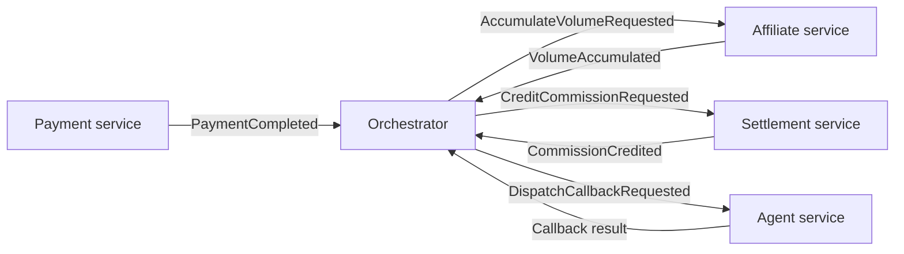
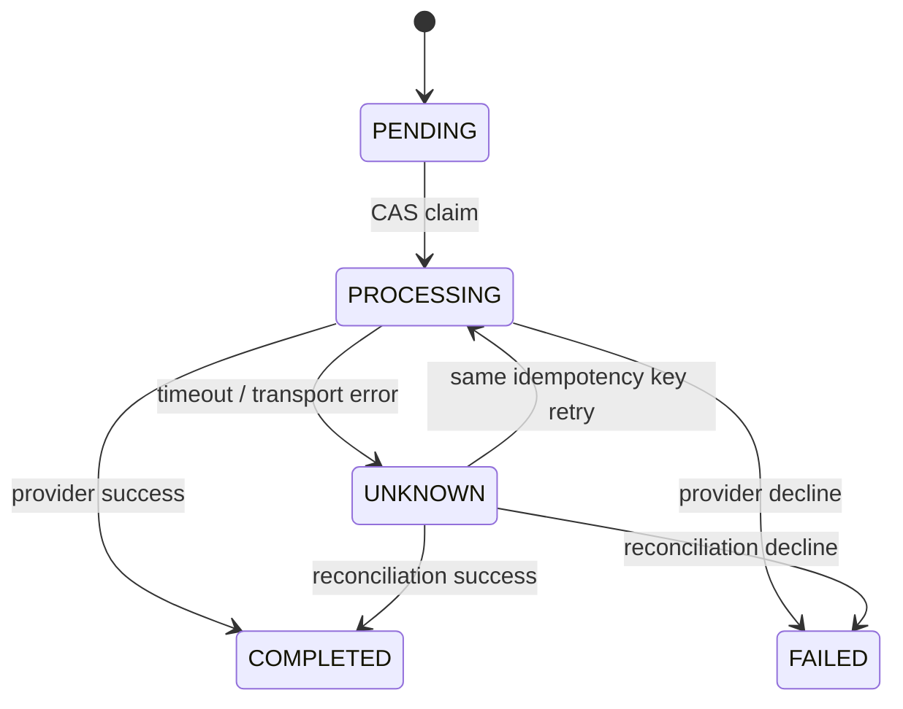
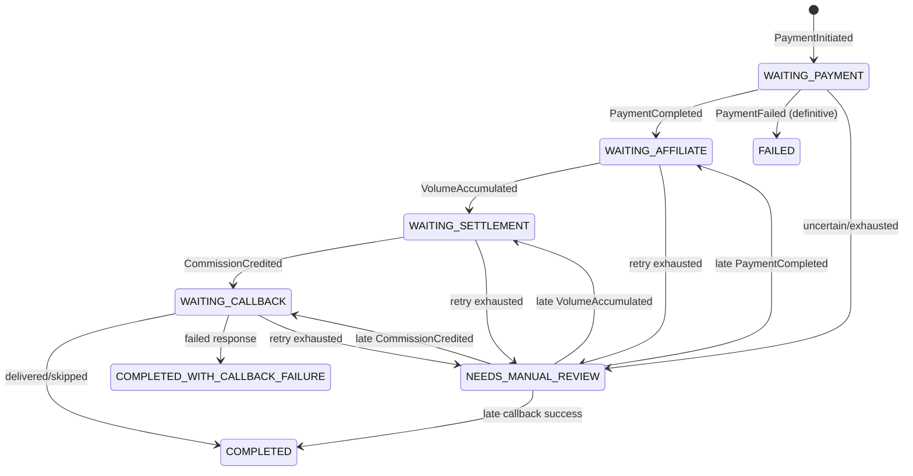

# Enterprise Saga, Temporal, and Transactional Outbox for Master Go CQRS

- **Document version:** 2.0
- **Baseline date:** 2026-08-13
- **Scope:** design decisions and invariants for payment → affiliate → settlement → agent callback
- **Status:** the target architecture is implemented in the core; local/k3d infrastructure remains a development environment.

This document is the source of truth for Saga, Temporal, Outbox/Inbox, and payment-idempotency semantics. Infrastructure configuration, SLOs, rollout procedures, and acceptance gates belong in [Production Operations](../operations/production.md); incident procedures belong in [Incident Runbooks](../operations/runbooks.md). For a learning-oriented walkthrough of the techniques and their current evidence, see the [CQRS and Service Integration Engineering Handbook](cqrs-service-integration-handbook.md).

---

## Chapter 1 — Decision summary

The core uses the following architecture:

1. **Temporal is the primary production orchestration engine.** The PostgreSQL Saga runtime remains available as a fallback engine and learning environment, but the two engines must not consume the same event stream concurrently.
2. **Kafka is the integration backbone**, with at-least-once delivery, `transaction_id` as the partition key, producer `acks=all`, and configurable TLS/mTLS and SASL.
3. **Transactional Outbox + Inbox** ensures that a local business write and its message intent commit together; a consumer applies its business effect and Inbox record in the same transaction.
4. **Idempotency exists at multiple layers**, not only in Kafka: API/provider keys, compare-and-swap payment claims, immutable Outbox `message_id`, Inbox key `(consumer_name, message_id)`, unique business ledgers, and Temporal signal deduplication.
5. **A timeout is not a failure.** An ambiguous outcome becomes `UNKNOWN` or `NEEDS_MANUAL_REVIEW`; a late event can recover the workflow. Only a definitive provider decline becomes `FAILED`.
6. **Reconciliation is a first-class flow.** A worker queries the provider by idempotency key/reference instead of blindly charging again.
7. **The polling Outbox is hardened and usable now.** At very high load, disable it with `OUTBOX_PUBLISHER_ENABLED=false` and replace it with the Debezium CDC Outbox Router.

In short, the selected patterns provide a sound path toward a large-scale system. The earlier implementation was not safe enough; version 2.0 closes the core correctness gaps. A claim such as “Grab/Shopee scale,” however, still depends on HA infrastructure, partitioning, schema governance, money representation, load tests, and round-the-clock operations. This document does not assume those capabilities are complete.

---

## Chapter 2 — The core business problem

A successful payment triggers a longer process:



No distributed database transaction spans all four services. Failure can occur at every boundary:

- a database commit succeeds, but the process dies before publishing;
- Kafka publishes successfully, but the producer loses the response;
- a consumer finishes its database work, but dies before committing the offset;
- the provider has charged the customer, but the HTTP/gRPC request times out;
- events from different topics arrive out of order;
- an old worker replays Workflow history after the code has changed;
- an Outbox lease expires while the old worker is still running;
- the callback fails after the payment and commission have been recorded.

The goal is therefore not “absolute exactly once.” The goal is:

> Each important business effect occurs once for its business identity, even when the transport delivers a message more than once.

---

## Chapter 3 — Mandatory invariants

### 3.1 Atomic local commit

Within each service, the following state must commit or roll back together:

```text
business state + domain event + outbox/inbox state
```

Repositories obtain the transaction from the context through `postgres.FromContext`. A handler binds `txCtx` before calling its repository, EventStore, and Outbox. Business-table updates no longer use a transaction while appending an event through a connection outside that transaction.

### 3.2 Immutable message identity

`message_id` describes one logical fact or command. Enqueuing the same ID again uses `DO NOTHING`: it does not update the payload, revive a `PROCESSED` row, or rewrite history.

### 3.3 Consumer-scoped Inbox

The Inbox primary key is:

```text
(consumer_name, message_id)
```

The same event may legitimately be processed by affiliate, settlement, and another projection. Only redelivery to the **same logical consumer** is deduplicated.

### 3.4 Business idempotency

The Inbox does not replace a unique business constraint. Settlement still has a unique transaction identity for its commission ledger. Payment uses one stable provider idempotency key for each logical charge.

### 3.5 Timeout is not failure

A timeout proves only that the system did not receive an outcome before the deadline. It does not prove that the provider or downstream command failed. Therefore:

- provider/system timeout → payment `UNKNOWN`;
- exhausted Saga/Temporal retry budget → `NEEDS_MANUAL_REVIEW`;
- definitive provider decline → `FAILED`;
- definitive callback response `FAILED` → `COMPLETED_WITH_CALLBACK_FAILURE`.

### 3.6 Late outcome is recoverable

`NEEDS_MANUAL_REVIEW` preserves `resume_state`. A compatible late event is applied to this state and the workflow continues. A stale or duplicate event must not clear the review state on its own.

### 3.7 Per-aggregate ordering

The Kafka key and Outbox `message_key` use `transaction_id`. An Outbox claim selects only the earliest incomplete row for each key; different keys may be published concurrently.

### 3.8 One orchestration owner

Only one of the `saga` or `temporal` engines consumes production topics in an environment. Running both creates duplicate commands even when downstream consumers are idempotent.

---

## Chapter 4 — Why Saga orchestration

### 4.1 Choreography versus orchestration

| Criterion | Pure choreography | Selected orchestration |
|---|---|---|
| Simple flow with few steps | Good fit | Slightly more ceremony |
| Multi-step payment flow | Difficult to see end to end | Centralized state machine |
| Retry/timeout | Distributed across services | Unified policy |
| State audit | Reconstruct from several topics | Query one Workflow/Saga |
| Step-order changes | Implicit consumer coupling | Versioned definition |
| Orchestrator blast radius | No central coordinator | Requires Temporal HA or Saga DB HA |

Choreography is not inherently wrong. It fits independent notification or propagation. Payment → volume → commission → callback is an ordered process with deadlines and explicit operational state, so orchestration is the better fit.

### 4.2 Two-phase commit versus Saga

| Criterion | Two-phase commit | Saga + local transaction |
|---|---|---|
| Cross-service atomicity | Yes, when every resource supports it | Eventual consistency |
| Availability | Coordinator and locks can have broad impact | Each service commits independently |
| Kafka/provider outside the DB | Difficult or impossible to include in XA | Natural fit through Outbox/Activity |
| Long-running process | Unsuitable for holding locks | Suitable for minutes, hours, or days |
| Compensation/reconciliation | Less often needed | Must be designed explicitly |

The core uses Saga because it integrates Kafka, a payment provider, and an external callback. Forcing these resources into 2PC would reduce availability without covering every external side effect.

### 4.3 Compensation is not a physical rollback

Do not delete a ledger row or silently reduce a balance. A future refund or reversal must be a new command and ledger entry:

```text
CommissionCredited(tx-1, +2.00)
CommissionReversed(tx-1, -2.00, reason, original_entry_id)
```

A callback failure does not reverse a payment or commission because the callback is a notification, not a financial invariant. The core retains the `COMPLETED_WITH_CALLBACK_FAILURE` outcome so callback retry and operations can proceed separately.

---

## Chapter 5 — Why Temporal is the primary production engine

Temporal stores Workflow Event History and replays deterministic code to resume after a crash or network outage. Temporal documents that a Workflow can run for months or years, orchestration code must remain deterministic, and API/DB calls belong in reliably retried Activities: [Temporal Go Workflow Versioning](https://docs.temporal.io/develop/go/workflows/versioning).

### 5.1 PostgreSQL Saga runtime versus Temporal

| Capability | PostgreSQL Saga runtime | Temporal |
|---|---|---|
| Durable state | `payment_sagas` row | Workflow history |
| Timer/retry | Custom reconciler | Native durable timer/retry |
| State query | SQL | Workflow Query/Search |
| Code upgrade | Maintain compatibility manually | Replay tests, patching, Worker Versioning |
| Out-of-order buffering | Custom code | Signal channel + Workflow state |
| Long human review | Separate scheduler required | Durable wait for a signal |
| Operational complexity | Lower initially | Requires Temporal cluster/Cloud |
| Large-scale fit | Possible, with substantial platform code | Better for long-running processes |

The custom Saga remains useful for local work, fallback, and demonstrating the pattern. The project should not keep rebuilding an entire durable-execution platform when Temporal already provides timers, history, signals, and deployment safety.

### 5.2 Workflow v2

The new Workflow uses `workflow.GetVersion("payment-orchestration-v2", DefaultVersion, 1)`:

- old histories follow the v1 code path;
- new Workflows follow v2;
- replay tests confirm that old history remains deterministic;
- the command-publishing Activity retries with exponential backoff;
- command-encoding errors are non-retryable;
- message IDs are retained in a bounded set of 256 entries;
- exhausting the business retry budget enters manual review and waits for a signal instead of closing with an incorrect result.

Temporal recommends Worker Versioning as the production default when versioned deployments with ramp, rollback, and Workflow Pinning are available: [Temporal Worker Versioning](https://docs.temporal.io/production-deployment/worker-deployments/worker-versioning).

The core supports:

```text
TEMPORAL_VERSIONING_ENABLED=true
TEMPORAL_DEPLOYMENT_NAME=payment-orchestrator
TEMPORAL_BUILD_ID=<immutable image digest or git sha>
```

The payment Workflow uses `PINNED`, which suits a short flow lasting minutes or hours. The v2 patch remains necessary to replay executions created before Worker Versioning was enabled.

### 5.3 Signal-With-Start and causal ordering

`PaymentInitiated` or `PaymentCompleted` uses Signal-With-Start with Workflow ID `payment:<transaction_id>`, closing the race between “check whether it exists” and “start/signal.” A downstream event cannot start a Workflow because it lacks amount/currency; if it arrives early, Kafka retries until the start event appears.

A signal sent to a closed Workflow is not silently swallowed. It is classified as permanent and routed to the DLQ so an operator can inspect a late or conflicting fact.

---

## Chapter 6 — Payment idempotency and unknown outcomes

### 6.1 State model



### 6.2 Claim before the external side effect

The required flow is:

1. the client sends an `Idempotency-Key`, or the core creates a stable key such as `payment:<tx>:charge`;
2. the repository uses CAS to move `PENDING`, `UNKNOWN` with the same key, or stale `PROCESSING` with the same key to `PROCESSING`;
3. only the caller that successfully claims the transaction calls the provider;
4. another caller receives conflict/in-progress and cannot charge concurrently;
5. the final state, domain event, and relay Outbox record commit in one local transaction.

A different key for a transaction that already has a key returns `ErrIdempotencyConflict`. A terminal transaction returns its existing result without calling the provider again.

### 6.3 Provider timeout

A provider timeout has three possible meanings: the request was not received, it was received but not charged, or it was charged and the response was lost. Because the core cannot distinguish these cases immediately, it emits `PaymentProcessingUncertain`, not `PaymentFailed`.

The payment reconciler periodically:

1. selects `UNKNOWN` and stale `PROCESSING` rows;
2. calls `LookupCharge(idempotency_key, provider_reference)`;
3. keeps waiting when `Found=false`;
4. resolves with CAS when the provider returns an authoritative success or decline;
5. commits the terminal state, event, and Outbox row in one transaction.

The reconciler **does not call `Charge`**. A production provider adapter must expose an idempotent lookup/status API.

---

## Chapter 7 — Transactional Outbox

### 7.1 Why an Outbox is required

PostgreSQL and Kafka cannot be committed atomically through one local database transaction. The Outbox records the publish intent in the same transaction as the business write. Debezium describes this pattern as a way to avoid inconsistencies between internal state and emitted events by capturing the Outbox table and applying the Outbox Event Router: [Debezium Outbox Event Router](https://debezium.io/documentation/reference/stable/transformations/outbox-event-router.html).

### 7.2 Hardened polling publisher

The current implementation provides:

- default batch size 500, 100 ms polling, and parallelism 16;
- immediate draining of full batches, removing the previous fixed ceiling of 20 messages/s;
- `FOR UPDATE ... SKIP LOCKED` for multiple workers;
- head-of-line claim only for each `message_key`;
- stale-lease recovery;
- `locked_by` fencing when marking processed/retry;
- exponential backoff;
- a retry budget of 20 before `DEAD`;
- a `DEAD` row blocks every later event for the same `message_key`, preventing causal skips;
- partial indexes for pending, processing, ordering, and retention;
- immutable duplicate enqueue behavior;
- exported queue-depth, oldest-age, and publish-outcome metrics through OTLP.

PostgreSQL notes that `SKIP LOCKED` is unsuitable for a general-purpose consistent view but can reduce contention for multiple consumers of a queue-like table: [PostgreSQL locking clause](https://www.postgresql.org/docs/current/sql-select.html#SQL-FOR-UPDATE-SHARE).

### 7.3 Polling or Debezium CDC

| Criterion | Hardened polling | Debezium CDC |
|---|---|---|
| Local setup | Simple | Requires Kafka Connect/connector |
| Database query load | Yes | Reads the WAL |
| Large backlog/latency | Depends on poll and batch settings | Better |
| Operational surface | Smaller | Larger |
| Ordering | Enforced by the core per key | Depends on connector/partition configuration |
| Recommendation | Local, moderate traffic, fallback | Very high production traffic |

Production CDC cutover:

1. deploy the connector in shadow mode to a verification topic;
2. compare `message_id`, lag, and counts;
3. stop the polling publisher with `OUTBOX_PUBLISHER_ENABLED=false`;
4. only then route CDC to production topics;
5. do not run polling and CDC as long-lived concurrent publishers.

---

## Chapter 8 — Transactional Inbox and exactly-once business effect

A consumer handler runs in a database transaction:

```text
INSERT inbox PROCESSING (ON CONFLICT DO NOTHING)
    -> business write
    -> domain event
    -> outbox enqueue
    -> UPDATE inbox PROCESSED
COMMIT
Kafka offset commit
```

If the process dies after the database commit but before the offset commit, Kafka redelivers the record. The Inbox detects the duplicate and prevents applying the business effect a second time.

Kafka producer idempotence removes duplicates inside its producer session/protocol; it does not eliminate application-level resends between services or after a restart. Apache Kafka also notes that an idempotent producer does not replace application resend checks, while an end-to-end Kafka transaction requires a read-committed consumer and transactional producer: [Kafka producer semantics](https://kafka.apache.org/40/javadoc/org/apache/kafka/clients/producer/KafkaProducer). Because the core commits PostgreSQL business data rather than only Kafka-to-Kafka data, the Inbox remains a mandatory boundary.

---

## Chapter 9 — Kafka contracts, ordering, and failure policy

### 9.1 Envelope v1

The envelope contains:

- `schema_version`;
- deterministic `id`;
- `event_type`;
- aggregate type, ID, and version;
- payload;
- occurrence time;
- correlation and causation IDs;
- W3C trace context in Kafka headers.

### 9.2 Durability

The producer uses synchronous writes and `RequireAll`. Kafka documents `acks=all` as its strongest producer guarantee; production should use replication factor 3 and `min.insync.replicas=2`: [Kafka producer configs](https://kafka.apache.org/40/configuration/producer-configs/) and [topic `min.insync.replicas`](https://kafka.apache.org/40/configuration/topic-level-configs/).

The current k3d manifest still uses `replication-factor=1`; that is a development topology only.

### 9.3 Retry and DLQ

- invalid JSON, envelope, or domain contract → immediate DLQ;
- retryable handler error → up to 8 attempts with exponential backoff capped at 30 seconds;
- exhausted budget → `<source-topic>.dlq`;
- commit the source offset only after handler success or successful DLQ publication;
- closed Temporal Workflow or conflicting late event → permanent/DLQ, never a silent drop;
- derive the DLQ ID from consumer group/topic/partition/offset and include source coordinates plus SHA-256;
- cap raw evidence so an oversized source record cannot stall the DLQ publisher;
- restart a consumer through the subscription supervisor after fetch, commit, or DLQ infrastructure failure.

This is bounded in-consumer retry. At extremely high throughput, use retry topics with delay tiers so a poison message does not hold a partition; track this requirement in the [production acceptance gates](../operations/production.md#13-production-acceptance-gates).

### 9.4 Security

The Kafka client supports:

- TLS 1.2+;
- an optional custom CA;
- an optional mTLS client certificate and key;
- SASL PLAIN, SCRAM-SHA-256, and SCRAM-SHA-512;
- rejection of SASL when TLS is disabled, preventing plaintext credential transmission.

---

## Chapter 10 — Detailed state machine

### 10.1 Happy path



### 10.2 Out-of-order event

Temporal buffers an `ErrNotReady` event in Workflow state. The custom Saga returns a retryable error for Kafka retry/DLQ handling. An event that is stale because the state has already passed that step is consumed as a semantic duplicate.

### 10.3 Conflicting event

If `PaymentFailed` arrives after downstream financial progress, the core does not rewrite history to `FAILED`. It enters manual review with the reason “conflicts with downstream progress.” An operator must verify both provider and ledger state.

---

## Chapter 11 — Data model and migrations

### 11.1 Payment

Migration `000005_harden_payment_processing` adds:

- `idempotency_key`;
- `provider_reference`;
- `last_error`;
- `processing_started_at`;
- a unique partial index for a non-empty idempotency key;
- a reconciliation index.

### 11.2 Inbox/Outbox

Payment, affiliate, settlement, agent, user, and orchestrator have separate migrations for:

- the composite Inbox primary key;
- the Inbox retention index;
- Outbox `dead_at`;
- partial indexes for pending, processing, ordering, and retention.

### 11.3 Saga runtime

Orchestrator migration `000004_add_recoverable_review_state` adds `resume_state` and a partial index for retry/manual-review records.

### 11.4 Migration safety

Roll out in this order:

1. perform a backup and restore drill;
2. apply additive columns and indexes;
3. deploy consumers that understand the new schema while still accepting envelope v1;
4. deploy the new producer;
5. enable a Temporal shadow/canary on isolated consumer groups without publishing production commands;
6. cut over to one orchestration owner;
7. enable Worker Versioning;
8. consider CDC only after the soak period.

A down migration can lose review and dead-letter metadata. Roll the schema back only after the old binary is running and the `DEAD` and manual-review rows have been exported.

---

## Chapter 12 — Failure matrix and expected behavior

| Failure | Core behavior | Operator action |
|---|---|---|
| Database rollback during initiation | No transaction, event, or Outbox row | Retry with the same business key when initiation idempotency is enabled |
| Database commit, process dies before Kafka | Outbox remains `PENDING` | Publisher/CDC sends it later |
| Kafka acknowledgement is lost | Outbox retry may duplicate | Inbox/business uniqueness removes duplicate effect |
| Outbox worker lease expires | A new worker claims the row | `locked_by` fencing prevents the old worker from mutating it |
| Provider timeout | Payment becomes `UNKNOWN` | Reconciler performs lookup, not blind retry |
| Provider decline | Payment becomes `FAILED` | Do not run affiliate/settlement |
| Downstream event arrives before start | Retry; do not start a Workflow without required data | Monitor retry/DLQ |
| Temporal worker crashes | Workflow replays | No operator action while the cluster is healthy |
| New Workflow code is deployed | `GetVersion` + pinned worker | Ramp, replay-test, and roll back the build if necessary |
| Callback fails | Financial flow remains unchanged | Retry/outreach through the callback path |
| Retry budget is exhausted | `NEEDS_MANUAL_REVIEW` | Reconcile or signal an authoritative event |
| Event reaches a closed Workflow | DLQ | Determine whether it is a duplicate or a real conflict |

Alert thresholds, topology, runtime configuration, rollout, and capacity evidence belong in [Production Operations](../operations/production.md). Manual response steps belong in [Incident Runbooks](../operations/runbooks.md), avoiding duplicated operational guidance in this design document.

---

## Chapter 13 — Testing strategy

### 13.1 Covered by the upgrade

- atomic repository transaction path;
- stable payment idempotency key;
- active claim does not call the provider;
- terminal replay does not charge again;
- timeout becomes `UNKNOWN`;
- reconciliation does not charge and resolves only an authoritative outcome;
- Inbox identity is scoped to the logical consumer;
- duplicate Outbox enqueue is immutable;
- stale Outbox worker fencing;
- `SKIP LOCKED` claim contract;
- definitive versus uncertain state transition;
- manual review recovered by a late event;
- custom Saga happy path, duplicate, out-of-order, and retry behavior;
- Temporal delayed/out-of-order signal, duplicate, and manual-review recovery;
- replay of old Temporal history;
- Signal-With-Start identity;
- closed Workflow classification;
- TLS/SASL configuration validation.

### 13.2 Required in CI

```bash
go test ./... -count=1
go test -race ./internal/platform/... ./services/payment/... ./services/orchestrator/...
go vet ./...
```

Add integration tests against real PostgreSQL, Kafka, and Temporal instances:

1. kill the process after the business commit but before publish;
2. kill a consumer after the database commit but before the offset commit;
3. run two Outbox workers against the same key;
4. trigger broker failover with `acks=all`;
5. trigger PostgreSQL failover between claim and finalize;
6. run a Temporal v1/v2 rainbow deployment and replay exported histories;
7. simulate provider accepted-but-timeout, then reconcile;
8. run chaos tests with 1–5% duplication, reordering, and delay;
9. soak-test backlog and retention cleanup.

### 13.3 Benchmark acceptance

Do not claim Grab/Shopee scale based on unit tests. A benchmark must disclose:

- hardware and topology;
- partition and replica counts;
- transaction cardinality and hot-key distribution;
- p50, p95, p99, and p99.9;
- steady and peak throughput;
- error, duplicate, retry, and reconciliation rates;
- recovery time after broker, database, or worker failure;
- Outbox and Temporal-history storage growth.

---

## Chapter 14 — Achieved outcomes and claim limits

### 14.1 Outcomes verified by code and tests

- closes the dual-write gap in the updated handlers;
- prevents concurrent blind charging through CAS claim;
- distinguishes a provider decline from an ambiguous timeout;
- provides a reconciliation path that does not charge again;
- prevents a duplicate consumer delivery from applying an effect twice for one logical consumer;
- makes multi-replica Outbox operation safer through ordered claims, stale recovery, fencing, and `DEAD` quarantine;
- bounds retries and routes to a DLQ instead of holding a partition indefinitely;
- gives DLQ replay/audit a deterministic source identity and bounded raw evidence;
- restarts a subscription instead of silently stopping after an infrastructure error;
- returns the same transaction for duplicate initiation with the same business key and rejects a conflicting payload;
- prevents Temporal from silently dropping a late event after close;
- replays old history with the new Workflow code;
- recovers manual review from a late authoritative event;
- exposes TLS/mTLS/SASL and Worker Versioning configuration in the core;
- connects OTLP traces/metrics, Temporal SDK observability, and PostgreSQL readiness to the runtime.

### 14.2 Expected outcomes that require a production-like benchmark

- the publisher no longer has a fixed ceiling of 20 messages/s;
- horizontal scaling follows the number of independent keys and Kafka partitions;
- Workflow query, manual review, and reconciliation reduce mean time to recovery;
- business identity guards reduce the probability of double charge/double credit;
- pinned versioning, ramp, and rollback make Workflow deployment safer.

The repository contains no benchmark that supports a specific throughput number. Expected improvements must not be presented as marketing measurements.

### 14.3 Readiness conclusion

| Level | Conclusion |
|---|---|
| Pattern/architecture | Suitable for a large system |
| Core correctness | Significantly improved; key invariants have tests |
| Local/k3d | Development-ready |
| Single-region production | Core is ready for production-like staging; launch depends on the [acceptance gates](../operations/production.md#13-production-acceptance-gates) and chaos/load evidence |
| Grab/Shopee scale | Cannot be confirmed from source alone; requires topology, SRE, capacity, and operational evidence |

“Best architecture” here does not mean using the greatest number of technologies. It means having one clear orchestration owner, strict local transactions, layered business idempotency, truthful timeout handling, reconciliation designed up front, and measurements behind every scale claim.

---

## Appendix A — Code map

| Capability | Primary location |
|---|---|
| Payment claim/idempotency | `services/payment/internal/application/command/process_payment.go` |
| Payment initiation idempotency | `services/payment/internal/application/command/initiate_payment.go` |
| Payment reconciliation | `services/payment/internal/application/command/reconcile_payments.go` |
| Payment persistence CAS | `services/payment/internal/adapter/persistence/postgres/repository.go` |
| Shared state machine | `services/orchestrator/internal/payment/definition.go` |
| Temporal Workflow v2 | `services/orchestrator/internal/payment/temporal/workflow_v2.go` |
| Temporal replay compatibility | `services/orchestrator/internal/payment/temporal/workflow.go` |
| Temporal ingress | `services/orchestrator/internal/payment/temporal/gateway.go` |
| Custom Saga fallback | `services/orchestrator/internal/payment/saga/` |
| Inbox | `internal/platform/inbox/` |
| Outbox | `internal/platform/outbox/` |
| Kafka producer/consumer/security | `internal/platform/kafka/` |
| Message contracts | `contracts/messagebus/contracts.go` |
| SQL migrations | `services/*/migrations/` |
| Production operations | `docs/operations/production.md` |
| Incident runbooks | `docs/operations/runbooks.md` |

## Appendix B — Short decision record

| ID | Decision | Reason |
|---|---|---|
| ADR-001 | Temporal primary, Saga fallback | Do not rebuild a durable-execution platform for production |
| ADR-002 | At-least-once + idempotent effect | Fits the database + Kafka + external-provider boundary |
| ADR-003 | Outbox/Inbox local transaction | Closes both the dual-write and consumer-redelivery gaps |
| ADR-004 | Timeout → review, not failure | Preserves business truth |
| ADR-005 | Harden polling first, CDC later | Provides a simple execution path and a high-scale path |
| ADR-006 | Pinned Worker Versioning + patch | Safe deployment/replay for short payment Workflows and old histories |
| ADR-007 | Reconciliation before compensation | Resolves the real outcome before creating a reversal |
