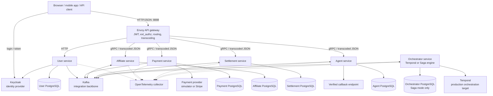
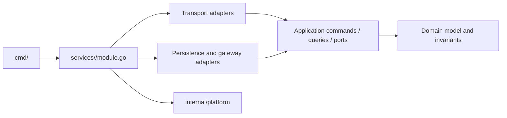
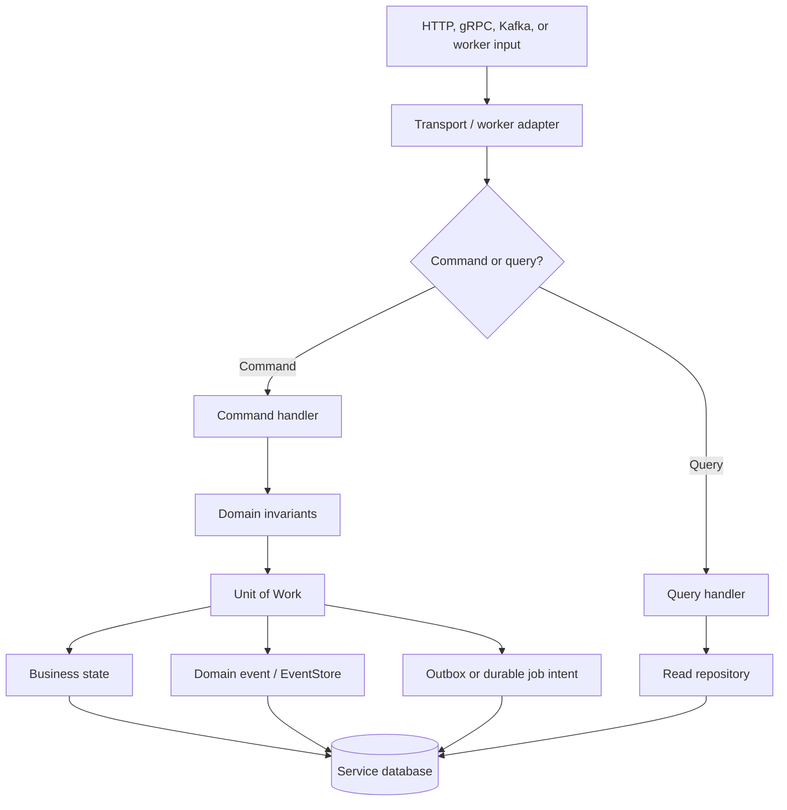
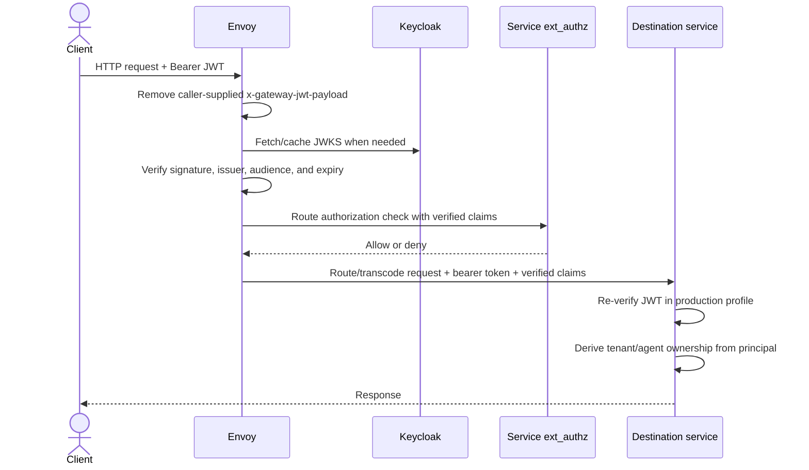

# System Architecture and Codebase Design

> **Source snapshot:** 2026-08-15
> **Scope:** system boundaries, service ownership, code structure, dependency direction, runtime composition, and communication paths.
> **Evidence boundary:** this document describes the current source and development topology. It does not claim that a production deployment is running or that production acceptance gates have passed.

Master Go CQRS is a Go monorepo containing six independently runnable services. Each service owns its domain model and PostgreSQL schema, exposes commands and queries through HTTP/gRPC adapters, and integrates asynchronously through Kafka. The payment business process is coordinated by exactly one orchestration engine: Temporal for the production target or the PostgreSQL-backed Saga runtime as a fallback.

Use the following documents for deeper concerns:

- [System Flows](system-flows.md) for request, event, recovery, callback, and identity-sync sequences.
- [Distributed Transactions](distributed-transactions.md) for Saga/Temporal, Outbox/Inbox, ordering, idempotency, and failure semantics.
- [CQRS and Service Integration Engineering Handbook](cqrs-service-integration-handbook.md) for a learning-oriented explanation and technique-to-source map.
- [Production Operations](../operations/production.md) for topology, HA, security profiles, SLOs, rollout, and acceptance gates.
- [Database Migrations](../operations/migrations.md) for schema ownership and migration locations.

---

## 1. Architecture at a glance

The design is built around five rules:

1. **A service owns its business state.** No other service reads or writes that service's database directly.
2. **Dependencies point inward.** Domain and application code do not depend on transports or persistence implementations.
3. **Synchronous calls serve immediate request/response needs.** Kafka carries durable cross-service facts and commands.
4. **A local transaction is the atomic boundary.** Cross-service consistency comes from Outbox, Inbox, idempotency, and orchestration—not from a distributed database transaction.
5. **Runtime claims are evidence-scoped.** Source-level safeguards and passing tests do not prove a highly available production topology.



The diagram shows logical ownership. In Temporal mode, the orchestrator uses Temporal Workflow history as durable process state and does not need the custom Saga database path. In Saga mode, it persists `payment_sagas`, Inbox, and Outbox state in the orchestrator database.

---

## 2. Service boundaries and responsibilities

| Service | Owns | Primary inputs | Durable outputs/integrations |
|---|---|---|---|
| **User** | authentication facade, local identity projection, access-control data, durable Keycloak sync jobs | public auth HTTP routes, protected user queries, EventStore polling | Keycloak calls, `user_identities`, `user_sync_jobs`, `UserRegistered`/`UserSynced`, `user.events` |
| **Payment** | payment transaction lifecycle, provider intent/reference, provider webhook evidence, reconciliation | v1/v2 payment HTTP/gRPC requests, Stripe webhook | payment DB, domain events, `payments.initiated`, `payments.events` |
| **Affiliate** | referral relationships, volume accumulation, ranks/downlines | HTTP/gRPC queries and `affiliate.commands` | affiliate DB, Inbox/Outbox, `affiliate.events` |
| **Settlement** | balances, credit limits, withdrawal intent, immutable commission effects | HTTP/gRPC requests and `settlement.commands` | settlement DB, Inbox/Outbox, `settlement.events` |
| **Agent** | agent configuration, API keys, callback verification, durable callback deliveries and audit | HTTP/gRPC configuration requests and `agent.commands` | agent DB, signed outbound callbacks, Inbox/Outbox, `agent.events` |
| **Orchestrator** | payment process state and ordered command decisions | payment, affiliate, settlement, and agent event topics | `affiliate.commands`, `settlement.commands`, `agent.commands`; Temporal history or Saga DB state |

Important ownership consequences:

- Payment does not update affiliate volume or settlement balances.
- Affiliate and settlement do not infer payment success from client requests; they act on orchestrator commands.
- Agent callback failure does not rewrite payment or ledger history.
- Orchestrator coordinates the process but does not own payment, referral, settlement, or agent business tables.
- Keycloak remains the identity provider; the User database is a local application projection and durable synchronization workspace.

---

## 3. Monorepo organization

The project is one Go module, `github/master_go_cqrs`, with separately runnable binaries and service-owned internal packages.

```text
.
├── cmd/                           # Thin main packages, one binary per service
│   ├── affiliate/
│   ├── agent/
│   ├── orchestrator/
│   ├── payment/
│   ├── settlement/
│   └── user/
├── contracts/
│   ├── proto/                     # Source Protobuf contracts
│   ├── genproto/                  # Generated Go/gRPC code
│   └── messagebus/                # Shared Kafka event/command payloads
├── internal/
│   ├── architecture/              # Dependency and Fx graph tests
│   ├── platform/                  # Shared runtime adapters and infrastructure
│   └── shared/                    # Framework-free shared value objects, e.g. Money
├── services/
│   ├── affiliate/
│   ├── agent/
│   ├── orchestrator/
│   ├── payment/
│   ├── settlement/
│   └── user/
├── dockers/
│   ├── envoy/                     # Gateway route source, template, and descriptor
│   └── k3d/                       # Development Kubernetes manifests
├── deploy/                        # Deployment profiles and production-oriented manifests
├── docs/
│   ├── architecture/              # Design and runtime semantics
│   ├── operations/                # Deployment and incident operations
│   ├── standards/                 # REST and Protobuf/gRPC conventions
│   └── api/                       # Generated OpenAPI JSON
├── tasks/                         # Taskfile modules
├── Taskfile.yml
└── go.mod
```

Generated files have explicit owners: edit `contracts/proto/*.proto` or annotated HTTP handlers, then regenerate artifacts. Do not hand-edit `contracts/genproto/`, `dockers/envoy/proto.pb`, or `docs/api/*.json`.

---

## 4. Architecture inside a service

A typical service follows Clean Architecture with CQRS-oriented application handlers:

```text
services/<service>/
├── module.go                         # Public service facade and Fx wiring
├── config/<service>.yaml             # Development defaults
├── migrations/                       # Service-owned PostgreSQL migrations
└── internal/
    ├── domain/                       # Entities, value objects, state rules, errors, events
    ├── application/
    │   ├── command/                  # State changes and transactional use cases
    │   ├── query/                    # Read-only use cases
    │   ├── dto/                      # Application boundary data
    │   └── port/                     # Interfaces owned by the application layer
    ├── adapter/
    │   ├── persistence/postgres/     # Repository and Unit-of-Work implementations
    │   └── gateway/                  # Keycloak, payment-provider, callback adapters
    └── transport/
        ├── http/                     # Echo routes and HTTP mapping
        ├── grpc/                     # gRPC service implementations
        └── consumer/                 # Kafka/EventStore/background workers
```

Not every service needs every folder. Orchestrator, for example, is organized around its shared payment process definition plus `saga/` and `temporal/` engine adapters.

### 4.1 Dependency direction



The repository enforces the following rules in `internal/architecture/architecture_test.go`:

1. `internal/platform/` and `contracts/` must not import a service.
2. A service must not import another service's packages.
3. Domain packages must not import application, adapter, transport, or platform packages.
4. Application packages must not import adapter or transport packages.
5. Transport packages must depend on application contracts rather than persistence adapters.
6. A `cmd/<service>` package may import only its matching top-level service facade.
7. Every service package must be reachable from a runnable command binary.

Go's `internal` visibility adds a compiler-level boundary, while the architecture test guards higher-level dependency direction.

### 4.2 Layer responsibilities

| Layer | Responsible for | Must not own |
|---|---|---|
| Domain | business states, valid transitions, value validation, domain errors/events | SQL, HTTP, gRPC, Kafka clients, framework wiring |
| Application | command/query orchestration, transaction scope, port interfaces, DTO mapping | concrete database/provider implementation |
| Adapter | PostgreSQL repositories, provider clients, callback clients, external-system translation | public transport semantics or business-policy invention |
| Transport | authentication context extraction, protocol validation, DTO/contract conversion, status/error mapping | direct database access or cross-service business rules |
| Service facade | choosing implementations and assembling the runtime graph | request-specific business behavior |

---

## 5. CQRS and local transaction boundaries

CQRS is logical in the current repository: commands and queries use separate handlers and interfaces, but normally share the same service-owned PostgreSQL database. There is no claim that a separate read database or projection store is deployed.



Command rules:

- Open a service-local transaction through the Unit of Work.
- Bind the transaction to context before calling repositories, EventStore, Inbox, or Outbox.
- Commit business state and durable message/job intent together.
- Keep external network I/O outside a long-lived database transaction unless the handler first uses a durable claim and later finalizes with compare-and-swap semantics.
- Use a stable business or provider idempotency key for retryable external effects.

Current exception: User registration crosses the Keycloak boundary before emitting `UserRegistered`. The HTTP handler currently logs an event-emission error and still returns registration success, and that event append is not enclosed with its relay Outbox enqueue in one Unit of Work. The durable sync guarantees described in [System Flows](system-flows.md#3-user-registration-and-durable-keycloak-synchronization) begin after the event has been stored; the earlier handoff remains a documented integration gap.

Query rules:

- Do not mutate aggregate state or enqueue integration messages.
- Read only from the owning service's repository.
- Return application DTOs rather than persistence models.
- Add a separate projection store only when measured read requirements justify it.

---

## 6. Runtime composition with Uber Fx

Each `cmd/<service>/main.go` is intentionally thin. It calls the matching service's `Options()` and lets Uber Fx construct and manage the graph:

```go
func main() {
    fx.New(payment.Options()).Run()
}
```

Each service facade exposes two conceptual levels:

- **`Module`** wires domain-specific repositories, handlers, transports, and workers.
- **`RuntimeModule` or `Options()`** adds configuration, logging, telemetry, PostgreSQL, Kafka, security, HTTP/gRPC servers, Inbox, Outbox, and EventStore as required.

| Runtime | Notable composed modules/workers |
|---|---|
| User | Keycloak adapter, PostgreSQL, service-boundary auth, EventStore relay, Kafka producer, Outbox, HTTP/gRPC, EventStore consumer, durable sync-job worker |
| Payment | PostgreSQL, provider adapter, service-boundary auth, EventStore relay, Kafka producer, Outbox, HTTP/gRPC v1+v2, payment reconciler |
| Affiliate | PostgreSQL, service-boundary auth, Kafka producer/consumer, Inbox/Outbox, EventStore, HTTP/gRPC, volume-command consumer |
| Settlement | PostgreSQL, service-boundary auth, Kafka producer/consumer, Inbox/Outbox, EventStore, HTTP/gRPC, commission-command consumer |
| Agent | PostgreSQL, service-boundary auth, Kafka producer/consumer, Inbox/Outbox, EventStore, HTTP/gRPC, callback-command consumer, durable callback worker |
| Orchestrator | common config/logging/telemetry/Kafka plus exactly one engine: Saga with PostgreSQL/Inbox/Outbox, or Temporal client/worker |

Lifecycle hooks start background workers and shut them down within a 30-second service lifecycle budget. `internal/architecture/fx_test.go` validates that the user, payment, affiliate, settlement, and agent dependency graphs can be constructed; orchestrator configuration is validated separately because its graph depends on the selected engine.

---

## 7. Data ownership and persistence

Every service has its own migration directory and database credentials. Sharing one physical PostgreSQL server in development does not weaken logical ownership.

| Database | Owning service | Representative durable state |
|---|---|---|
| `master_go_cqrs_user` | User | identity projection, EventStore data, durable sync jobs, Outbox |
| `master_go_cqrs_payment` | Payment | transactions/payment intents, provider evidence, EventStore data, Outbox |
| `master_go_cqrs_affiliate` | Affiliate | referrals/ranks/volume, Inbox, Outbox, domain events |
| `master_go_cqrs_settlement` | Settlement | balances, credit limits, commission ledger, Inbox, Outbox, domain events |
| `master_go_cqrs_agent` | Agent | callback configuration/challenges, API keys, callback deliveries, Inbox, Outbox, audit data |
| `master_go_cqrs_orchestrator` | Orchestrator Saga engine | payment Saga snapshots, retry/review state, Inbox, Outbox |

Cross-database SQL joins, shared ORM models, and another service's repository imports are prohibited. Cross-service facts travel through versioned Kafka contracts; immediate request/response integration uses explicit gRPC or external-provider ports.

See [Database Migrations](../operations/migrations.md) for the canonical schema and migration index.

---

## 8. Communication and contract ownership

### 8.1 Synchronous paths

- Envoy exposes the public HTTP/JSON surface on port `8888`.
- User authentication routes are handled over HTTP because they proxy Keycloak login, registration, refresh, and user information operations.
- Payment, affiliate, settlement, and agent public APIs are primarily routed to gRPC services through Envoy JSON transcoding.
- The Stripe webhook is deliberately routed to the Payment HTTP listener because signature verification requires the exact raw request body.
- External integrations are represented by application-owned ports, with adapters for Keycloak, the payment provider, and callback endpoints.

### 8.2 Asynchronous paths

| Topic | Producer | Consumer | Contract role |
|---|---|---|---|
| `payments.initiated` | Payment EventStore relay | Selected orchestrator engine | establish payment-process identity and initial data |
| `payments.events` | Payment EventStore relay | Selected orchestrator engine | definitive success/failure or uncertain outcome |
| `affiliate.commands` | Orchestrator | Affiliate | request idempotent volume accumulation |
| `affiliate.events` | Affiliate | Orchestrator | report accumulated volume and rank |
| `settlement.commands` | Orchestrator | Settlement | request idempotent commission credit |
| `settlement.events` | Settlement | Orchestrator | report commission credit outcome |
| `agent.commands` | Orchestrator | Agent | request durable callback dispatch |
| `agent.events` | Agent | Orchestrator | report delivered, skipped, or terminal callback failure |
| `user.events` | User EventStore relay | external/internal subscribers as added | publish identity-domain facts |

Messages use `transaction_id` as the key for payment orchestration, preserving per-transaction partition order. The envelope carries event identity, aggregate identity/version, tenant, orchestration owner/generation, correlation/causation, and W3C trace context. JSON remains the compatibility default; Protobuf plus Schema Registry is an explicit versioned migration path and fails closed rather than silently falling back to JSON.

### 8.3 API and schema sources

- `contracts/proto/*.proto` owns gRPC and transcoding contracts.
- `contracts/messagebus/` owns shared event/command payloads.
- `dockers/envoy/shared/routes.yaml` is the gateway route source of truth.
- `docs/api/*.json` contains generated OpenAPI artifacts.
- [REST API Standards](../standards/rest-api.md) and [Protobuf and gRPC Standards](../standards/protobuf-grpc.md) define compatibility rules.

---

## 9. Gateway and trust boundaries



Security responsibilities are deliberately layered:

1. Envoy strips any client-supplied `x-gateway-jwt-payload` header before `jwt_authn` writes verified claims.
2. Envoy verifies the token through Keycloak JWKS and applies route-level `ext_authz` policy.
3. Protected HTTP and gRPC handlers authenticate the service-boundary principal. With `AUTH_JWT_REQUIRED=true`, services independently validate bearer signature, issuer, audience, and expiry; forwarded claims remain a local-development compatibility path only.
4. Application handlers derive tenant and agent ownership from the verified principal, not from request-body identifiers.
5. A public route still owns its protocol-specific verification. The Stripe webhook, for example, is public at the JWT layer but validates the provider signature over the exact raw bytes.

Authentication proves the caller identity. Authorization and ownership checks remain a service responsibility.

---

## 10. Distributed consistency model

The architecture does not promise transport-level exactly-once delivery. It provides exactly-once **business effects within implemented invariants**:

```text
atomic local commit
+ at-least-once publication/delivery
+ immutable message identity
+ consumer-scoped Inbox
+ business uniqueness and idempotency
+ one orchestration owner
= one business effect for one business identity
```

Payment processing adds a provider idempotency key and a CAS claim before the external side effect. Ambiguous provider timeouts become `UNKNOWN`; reconciliation queries the provider rather than charging again. The orchestrator orders affiliate, settlement, and callback commands and moves exhausted or conflicting cases to manual review instead of inventing a successful or failed outcome.

The full state machine, retry policy, and failure matrix are defined in [Distributed Transactions](distributed-transactions.md).

---

## 11. Cross-cutting platform capabilities

`internal/platform/` provides reusable infrastructure without importing service code:

| Package area | Responsibility |
|---|---|
| `config` | YAML plus environment configuration, validation, Kafka/PostgreSQL/OTel settings |
| `postgres` | GORM/database setup, transaction context, connection pool, readiness |
| `eventstore` | append-only domain events, versioning, consumer checkpoints, relay to Outbox |
| `outbox` | immutable publish intent, leasing/fencing, ordered polling, retry/dead state |
| `inbox` | consumer-scoped deduplication and atomic processed state |
| `kafka` | producer, consumer, subscriptions, retry/DLQ, TLS/SASL, JSON/Protobuf codecs |
| `httpapi` / `grpc` | shared server lifecycle, middleware, health endpoints, transport registration |
| `security/gatewayauth` | JWT verification, principal context, resource authorization, ownership helpers |
| `observability` | structured logging, tracing, metrics, OTLP exporters |

W3C trace context is propagated through HTTP, gRPC, Outbox, and Kafka. High-cardinality identifiers such as `transaction_id`, `message_id`, and provider references belong in logs and traces, not metric labels.

---

## 12. Development topology versus production architecture

The checked-in k3d profile is a reproducible development environment, not production evidence.

| Component | Development source truth | Architectural production expectation |
|---|---|---|
| Gateway | Envoy exposed on `:8888` | managed TLS, resilient ingress, rate limiting, hardened policies |
| User | HTTP `:8889` | independently scalable API/workers |
| Payment | HTTP `:8081`, gRPC `:9081` | separate API and background-worker scaling when required |
| Affiliate | HTTP `:8082`, gRPC `:9082` | replicas scaled by API load and Kafka lag |
| Settlement | HTTP `:8083`, gRPC `:9083` | replicas scaled by API load and Kafka lag |
| Agent | HTTP `:8084`, gRPC `:9084` | API and callback workers scaled independently |
| Orchestrator | background process, no public route | one selected engine with isolated task/consumer ownership |
| Kafka | single-broker k3d topics with replication factor 1 | multi-AZ durability profile and measured partition capacity |
| PostgreSQL | development instance with service databases | service-owned HA databases with tested recovery |
| Temporal | development server/profile | Temporal Cloud or a verified HA cluster |

Telepresence-based tasks can run a service locally while it reaches in-cluster dependencies. That improves the developer loop but does not change service boundaries or count as production verification.

For deployable topology and acceptance criteria, use [Production Operations](../operations/production.md).

---

## 13. Architectural decision summary

| Decision | Consequence |
|---|---|
| Database per service | clear ownership and independent migrations; cross-service joins become explicit integrations |
| Clean Architecture + ports/adapters | core use cases are testable without transport or provider implementations |
| Logical CQRS | command/query separation without prematurely operating two databases |
| Kafka integration backbone | durable decoupling with explicit eventual consistency and duplicate handling |
| Outbox + Inbox | closes local dual-write and redelivery gaps within service transaction boundaries |
| Temporal primary, Saga fallback | durable production workflow target with a simpler fallback/learning runtime |
| Envoy gateway + service verification | defense in depth at both public ingress and service boundaries |
| Versioned contracts and generated specs | compatibility is reviewed at source definitions rather than hand-edited artifacts |

## 14. Source map

| Concern | Primary source |
|---|---|
| Binary entry points | `cmd/*/main.go` |
| Service runtime graphs | `services/*/module.go` |
| Dependency rules | `internal/architecture/architecture_test.go` |
| Fx graph validation | `internal/architecture/fx_test.go` |
| Shared configuration | `internal/platform/config/config.go` |
| Gateway routes | `dockers/envoy/shared/routes.yaml` |
| JWT/service-boundary auth | `internal/platform/security/gatewayauth/` |
| Kafka topics and clients | `services/*/config/*.yaml`, `internal/platform/kafka/` |
| Payment orchestration definition | `services/orchestrator/internal/payment/definition.go` |
| Saga engine | `services/orchestrator/internal/payment/saga/` |
| Temporal engine | `services/orchestrator/internal/payment/temporal/` |
| Service migrations | `services/*/migrations/` |
| Development workloads | `dockers/k3d/manifests/` |
