# System Flows

> **Source snapshot:** 2026-08-15
> **Scope:** the principal synchronous, asynchronous, and recovery paths implemented by the current source.
> **Evidence boundary:** diagrams describe code-level behavior and the development topology; they do not prove a live production deployment.

This document is the interaction map for the runtime. It shows where trust changes, where a transaction begins and ends, which component owns an external side effect, and how an at-least-once delivery becomes an idempotent business effect.

Detailed invariants and state-machine rules belong in [Distributed Transactions](distributed-transactions.md). Component boundaries belong in [System Architecture](overview.md). Production tuning, SLOs, and deployment gates belong in [Production Operations](../operations/production.md).

## 1. Reading the diagrams

The flows use these terms consistently:

| Term | Meaning |
|---|---|
| **Local transaction** | one transaction in one service-owned PostgreSQL database |
| **Domain event** | an immutable fact appended to the service EventStore or emitted by a domain handler |
| **Outbox intent** | a durable request to publish a Kafka message after the local transaction commits |
| **Inbox claim** | consumer-scoped deduplication for one `(consumer_name, message_id)` |
| **Business idempotency** | a stable API/provider/ledger identity that prevents a repeated business effect |
| **At least once** | publication or delivery may repeat after a crash or lost acknowledgement |
| **Authoritative outcome** | a result proven by provider/downstream state, not inferred from a timeout |

The core delivery equation is:

```text
local atomic commit + at-least-once delivery + idempotent consumer = one business effect
```

---

## 2. Authentication and protected request flow

### 2.1 Login and token issuance

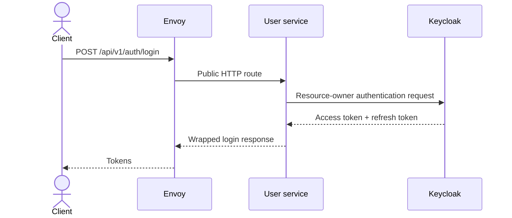

Login, refresh, registration, documentation, health endpoints, and the Stripe webhook are public at the gateway JWT layer. “Public” means the route does not require a caller JWT; it does not remove provider-signature validation, input validation, rate limiting, or other route-specific controls.

### 2.2 Protected request

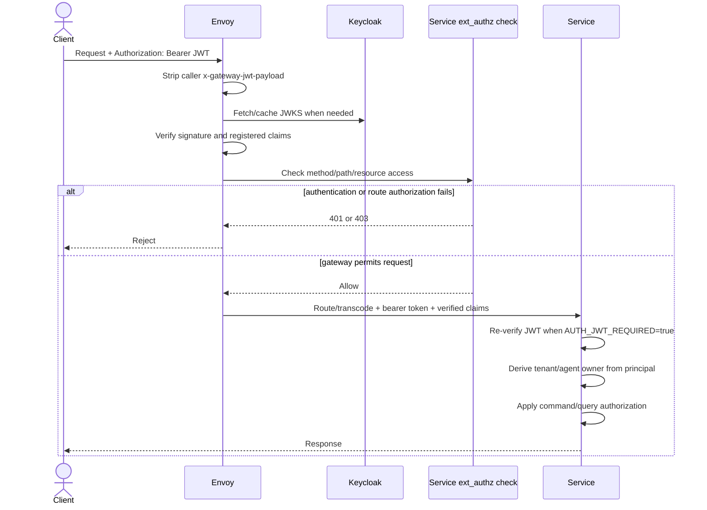

The client cannot establish ownership by sending `agent_id` or `tenant_id` in the request body. Protected handlers use the verified principal. A lookup for another owner's payment returns not-found rather than revealing that the resource exists.

---

## 3. User registration and durable Keycloak synchronization

Registration creates the identity in Keycloak first, then attempts to record the event that feeds durable synchronization. The durable path begins only after `UserRegistered` exists in the User database.

```mermaid
sequenceDiagram
    actor Client
    participant User as User HTTP handler
    participant Keycloak
    participant UserDB as User PostgreSQL
    participant EventWorker as EventStore consumer
    participant SyncWorker as Sync-job worker

    Client->>User: POST /api/v1/auth/register
    User->>Keycloak: Create identity
    Keycloak-->>User: Token containing provider subject
    User->>UserDB: Append UserRegistered and attempt relay Outbox enqueue
    opt local event emission fails
        User->>User: Log failure; current handler does not fail registration
    end
    User-->>Client: Registration response

    EventWorker->>UserDB: Claim UserRegistered through consumer checkpoint
    EventWorker->>UserDB: Same transaction: insert deduplicated sync job + advance checkpoint

    SyncWorker->>UserDB: Lease one job/page
    SyncWorker->>Keycloak: Fetch user or bounded page outside DB transaction
    Keycloak-->>SyncWorker: Identity data
    SyncWorker->>UserDB: Local transaction: upsert identity + append UserSynced + advance cursor

```

Key failure properties:

- Keycloak creation and local event emission cannot share a transaction. In the current source, registration still succeeds when `EmitUserRegistered` fails; an explicit retry/reconciliation trigger is therefore still required to guarantee repair of that handoff.
- `EmitUserRegistered` is not wrapped in a Unit of Work. The EventStore append may persist before the matching Outbox enqueue fails. Local EventStore polling can still create the sync job, but `user.events` publication is not guaranteed for that failure window.
- Event consumption and sync-job creation commit together; a crash cannot advance the checkpoint without preserving work.
- Keycloak I/O is outside the database transaction and bounded by `providerTimeout`.
- A full sync advances one page and cursor per transaction, so it is restart-safe and fairly schedulable.
- The job uses a lease token, bounded attempts, and exponential backoff.
- The local `user_identities` table is a projection; Keycloak remains the external identity authority.
- Full-sync enqueue and execution handlers exist, but this source snapshot does not expose a transport or scheduled trigger for them; wiring that trigger remains an operational integration gap.

---

## 4. Payment initiation and provider outcome

The source contains a legacy learning flow and a modern v2 PaymentIntent flow. Both produce the same orchestration facts, but their provider interactions differ.

### 4.1 Modern v2 PaymentIntent creation

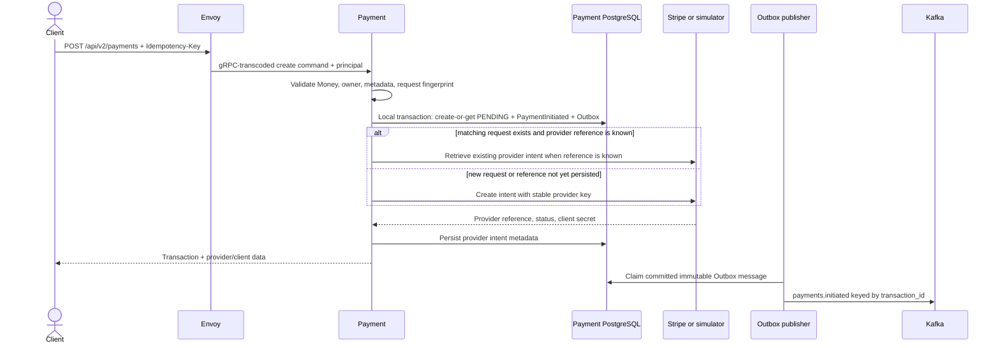

The API idempotency key identifies the create request; a request fingerprint rejects reuse with conflicting money, owner, callback endpoint, or metadata. The provider intent uses a separate stable key derived from the internal transaction ID. Money v2 uses integer minor units, currency, and exponent; the legacy floating-point field exists only for compatibility.

### 4.2 Provider webhook

```mermaid
sequenceDiagram
    participant Provider as Stripe
    participant Envoy
    participant PaymentHTTP as Payment raw HTTP route
    participant PaymentDB as Payment PostgreSQL
    participant Publisher as Outbox publisher
    participant Kafka

    Provider->>Envoy: POST /api/v2/payments/webhooks/stripe
    Envoy->>PaymentHTTP: Preserve exact raw body
    PaymentHTTP->>PaymentHTTP: Verify signature, timestamp tolerance, body size
    PaymentHTTP->>PaymentDB: Begin local transaction
    PaymentDB->>PaymentDB: Insert provider event by unique provider event ID
    alt duplicate webhook
        PaymentDB-->>PaymentHTTP: Already processed; no duplicate effect
    else valid new event
        PaymentDB->>PaymentDB: Apply monotonic provider outcome
        PaymentDB->>PaymentDB: Append terminal event + matching Outbox intent
        PaymentDB->>PaymentDB: Mark provider event processed/ignored
    end
    PaymentHTTP-->>Provider: Acknowledge
    Publisher->>PaymentDB: Claim committed terminal fact
    Publisher->>Kafka: payments.events keyed by transaction_id
```

The webhook is public only because it authenticates the provider through the signature rather than a user JWT. A terminal payment cannot be overwritten by a conflicting late provider event. Duplicate provider events are deduplicated before applying state.

### 4.3 Legacy charge and ambiguous timeout

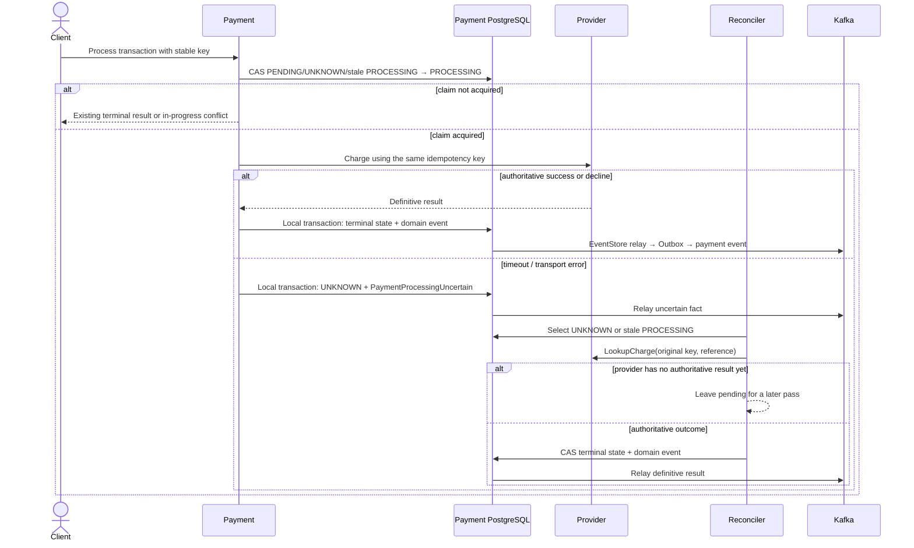

The reconciler never calls `Charge`. A timeout cannot distinguish “not received,” “received but not charged,” and “charged but response lost,” so it must not be converted into a decline. See [Payment idempotency and unknown outcomes](distributed-transactions.md#chapter-6--payment-idempotency-and-unknown-outcomes).

---

## 5. End-to-end payment orchestration

Exactly one engine owns this process in an environment. `ORCHESTRATOR_ENGINE=temporal` selects Temporal; `saga` selects the PostgreSQL-backed fallback. Consumer groups isolate the selected engine and generation, while message envelopes carry the orchestration owner and generation. A cutover must still ensure that two engines do not produce commands concurrently.

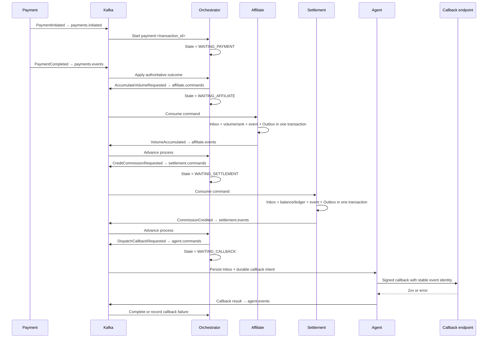

### 5.1 State transitions

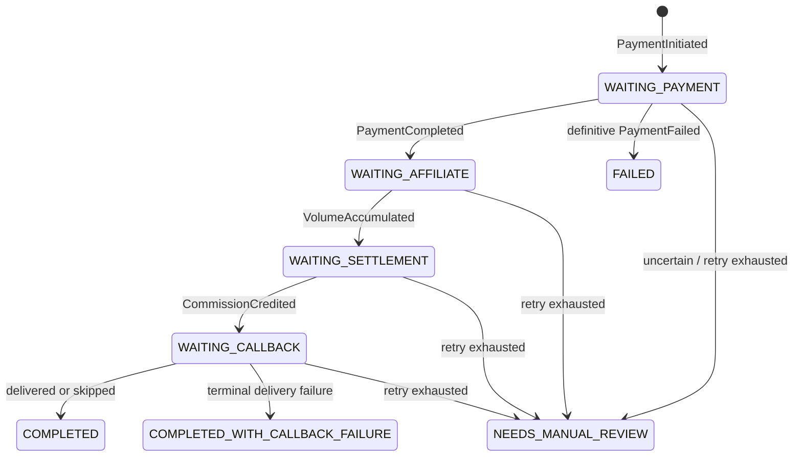

`PaymentFailed` stops the financial process only when it is authoritative and arrives before downstream financial progress. A conflicting failure after volume or settlement progress moves to manual review rather than rewriting history.

### 5.2 Temporal and Saga behavior

| Concern | Temporal engine | PostgreSQL Saga engine |
|---|---|---|
| Process identity | Workflow ID `payment:<transaction_id>` | `payment_sagas.transaction_id` |
| Durable state | Workflow history | Saga snapshot row |
| Start race | Signal-With-Start | row lock/create in event transaction |
| Timer/retry | durable Workflow timers and Activities | reconciler using `next_retry_at` |
| Duplicate event | bounded Workflow message-ID set + state semantics | Inbox + state semantics |
| Out-of-order event | Workflow buffers/re-evaluates not-ready facts | retryable error through Kafka policy |
| Code upgrade | `GetVersion`, replay tests, optional pinned Worker Versioning | application/schema compatibility |

Both engines use the same pure payment process definition for valid transitions and commands.

---

## 6. Transactional Outbox publication

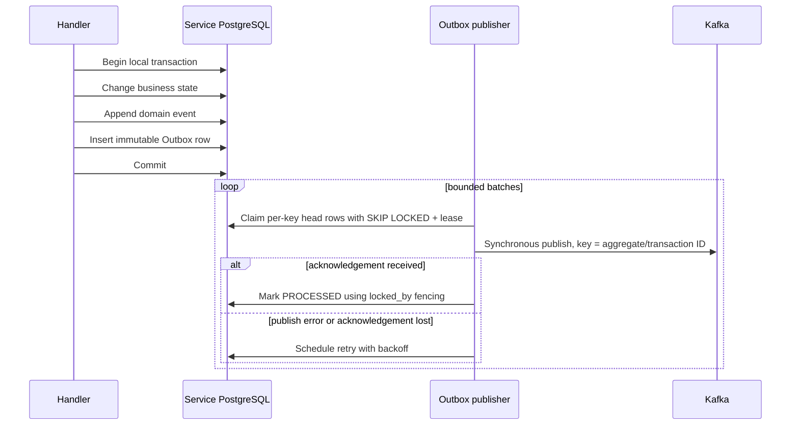

Crash reasoning:

| Crash point | Durable state | Recovery |
|---|---|---|
| before database commit | neither business change nor message intent exists | retry the command using business/API idempotency |
| after database commit, before publish | business change and `PENDING` Outbox row exist | publisher or CDC sends later |
| after Kafka accepted, before `PROCESSED` | Kafka may contain the record while Outbox is retryable | duplicate publication is expected; consumer deduplicates |
| after lease expiry while old worker runs | another worker may claim | `locked_by` fencing prevents stale finalization |

A `DEAD` row quarantines later rows with the same `message_key`; causal order is not bypassed automatically.

---

## 7. Transactional Inbox consumption

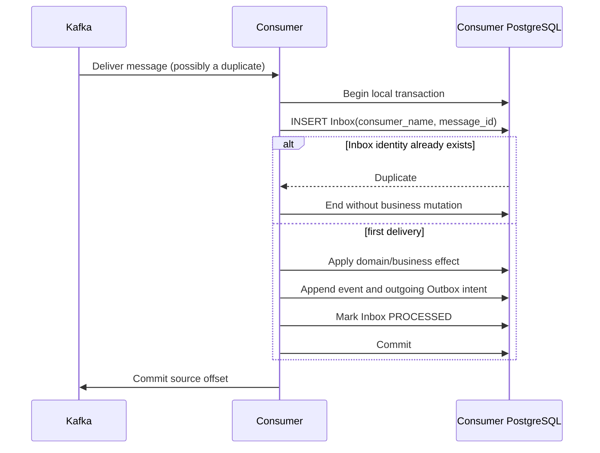

If the process dies after the database commit but before the offset commit, redelivery finds the Inbox identity and does not apply the effect again. Inbox deduplication is necessary but not sufficient: affiliate volume and settlement commission also use stable transaction identities and database uniqueness to protect the business invariant.

Consumer failure classification:

- malformed envelope, unsupported event type, invalid money, or impossible identity → permanent failure and DLQ;
- transient database/downstream failure → bounded retry with exponential backoff;
- exhausted retry budget → `<source-topic>.dlq`;
- the source offset commits only after successful handling or successful DLQ publication;
- a fetch, offset-commit, or DLQ-infrastructure failure causes the subscription supervisor to restart the reader.

---

## 8. Callback onboarding and durable delivery

### 8.1 Endpoint registration and ownership proof

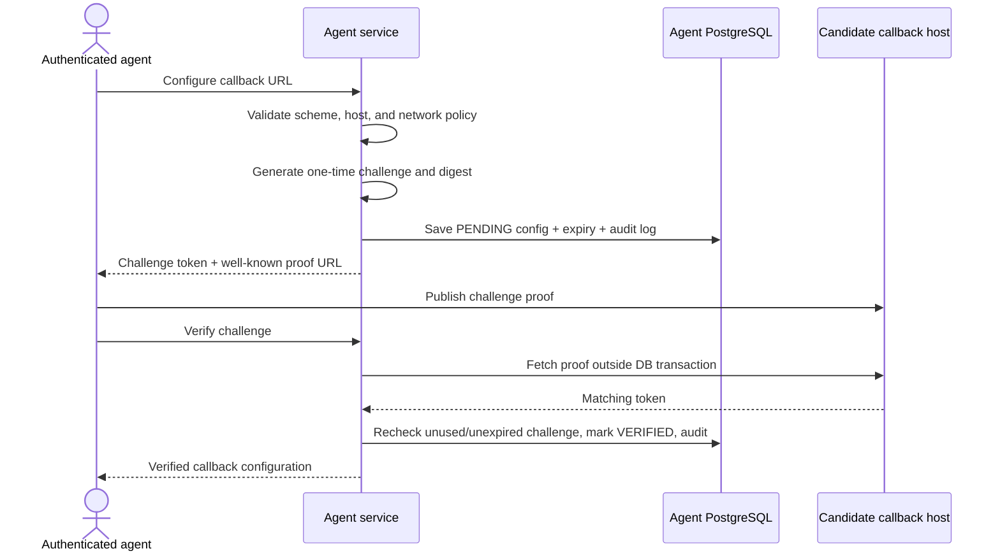

Production configuration requires HTTPS and a verified-domain allowlist. The proof fetch happens outside the short commit transaction. The stored challenge is a digest, and verification rejects expired, reused, mismatched-tenant, or mismatched-agent challenges.

### 8.2 Callback command and delivery worker

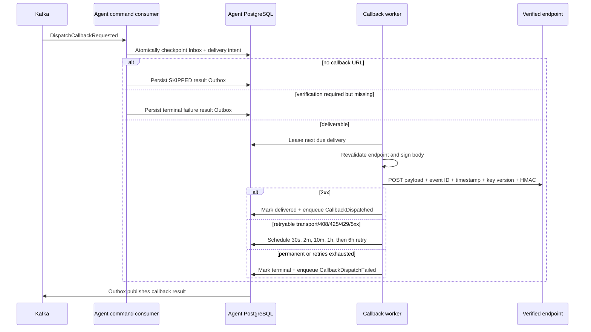

The callback network call never occurs while the Kafka handler holds the Inbox transaction. Delivery uses a stable `event_id` as both application identity and callback idempotency key. A platform operator may explicitly replay a terminal delivery with actor and reason; normal callers cannot silently revive it.

Callback failure is a notification failure. It does not reverse payment or commission state.

---

## 9. CQRS request paths

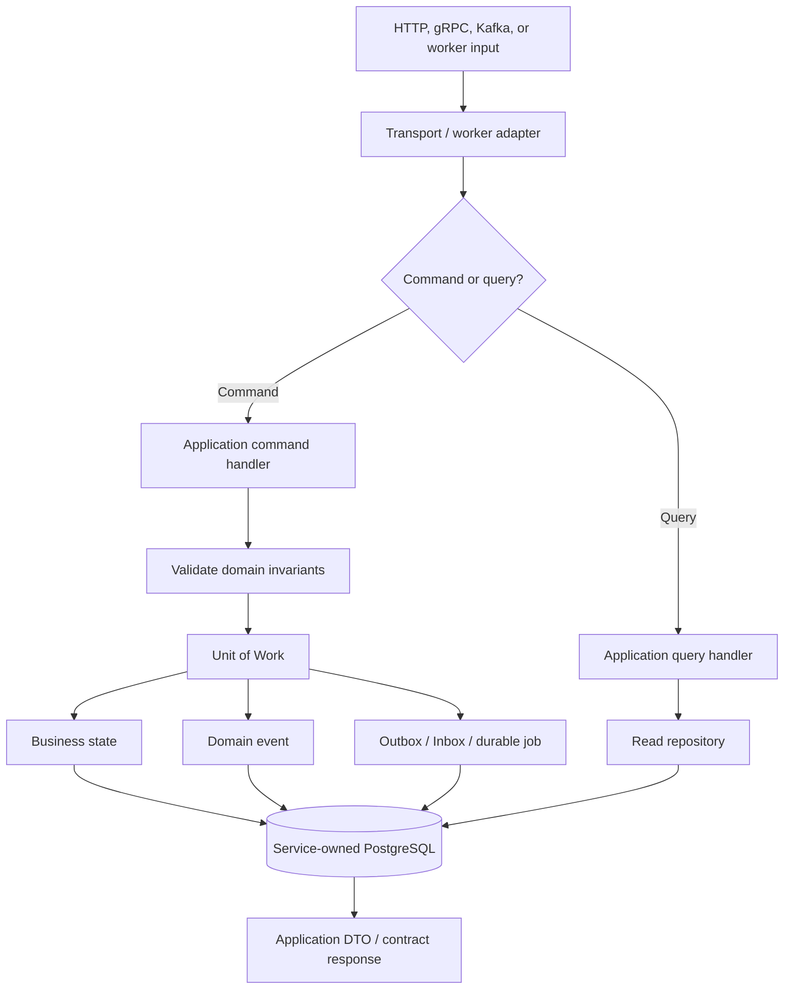

Commands own state transitions and transactional side effects. Queries are read-only and do not enqueue messages. The current CQRS split is logical; read and write handlers normally use the same owning database.

---

## 10. Trace and identity propagation

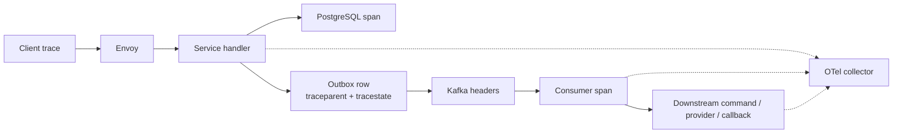

The message envelope and Outbox persist correlation, causation, tenant, orchestration owner/generation, and W3C trace context. A consumer extracts that context before starting its span and propagates it into new outgoing messages.

Use logs/traces for high-cardinality fields such as `transaction_id`, `message_id`, provider reference, tenant ID, and callback event ID. Metrics use bounded labels such as service, topic, event type, and outcome.

---

## 11. Contract evolution flow

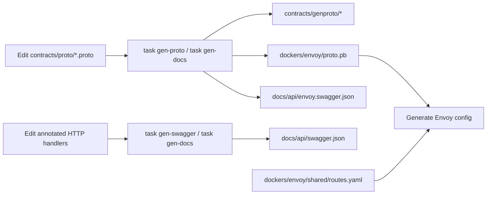

Compatibility rules:

- add fields with new numbers; never reuse a removed Protobuf field number;
- reserve removed field names/numbers;
- regenerate descriptors and OpenAPI from source instead of editing artifacts;
- keep legacy JSON topics while migrating dedicated v2 topics to Protobuf/Schema Registry;
- fail closed when Protobuf/Schema Registry is configured incorrectly—do not publish unexpected JSON to the same topic;
- use immutable event identity across version adapters so a format migration cannot duplicate the business effect.

See [Protobuf and gRPC Standards](../standards/protobuf-grpc.md) and [REST API Standards](../standards/rest-api.md) for detailed compatibility policy.

---

## 12. Failure-to-recovery index

| Failure | Flow that absorbs it | Result |
|---|---|---|
| repeated API create request | request idempotency key + fingerprint + create-or-get | same transaction or explicit conflict |
| provider charge timeout | payment `UNKNOWN` + lookup-only reconciler | no blind second charge |
| duplicate provider webhook | unique provider event ID | one state transition/event |
| process dies after local commit | EventStore relay/Outbox | message is published later |
| Kafka acknowledgement lost | immutable Outbox retry + Inbox/business identity | duplicate transport, one business effect |
| consumer dies before offset commit | Inbox record in business transaction | safe redelivery |
| out-of-order orchestration event | Temporal buffering or Saga retry policy | wait/retry rather than invalid transition |
| retry budget exhausted | `NEEDS_MANUAL_REVIEW` with `resume_state` | late authoritative event can resume |
| callback endpoint transient failure | durable schedule with bounded backoff | retry without blocking Kafka partition |
| callback endpoint permanent failure | terminal callback event | financial state remains intact |
| malformed/poison Kafka record | permanent classification + DLQ | evidence preserved, partition released after DLQ publish |
| Workflow code changes | replay test + `GetVersion` + optional Worker Versioning | deterministic history compatibility |

Operator actions for these states are documented in [Incident Runbooks](../operations/runbooks.md); alert thresholds and rollout gates are documented in [Production Operations](../operations/production.md).
