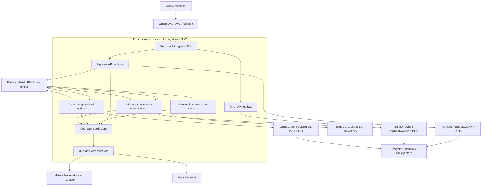

# Production operations cho Saga, Temporal và Transactional Outbox

> **Trạng thái source:** 2026-08-14
>
> **Phạm vi:** payment orchestration, Kafka, Temporal, PostgreSQL, Inbox/Outbox và observability.
>
> Tài liệu này là production reference architecture; `dockers/k3d` vẫn chỉ là môi trường development. Semantics của distributed transaction nằm trong [Distributed Transactions](../architecture/distributed-transactions.md); phản ứng sự cố nằm trong [Incident Runbooks](runbooks.md).

## 1. Phạm vi và kết luận triển khai

Tài liệu này giả định các invariant trong [Distributed Transactions](../architecture/distributed-transactions.md) đã được giữ nguyên, rồi định nghĩa phần còn thiếu để vận hành production một region: failure domain, HA, TLS, connection budget, observability, rollout và acceptance evidence.

Source đã có các primitive cần thiết cho staging production-like và Stripe PaymentIntent adapter, nhưng source code không tự chứng minh một production topology hay Stripe account runtime. Launch vẫn phụ thuộc vào các [production acceptance gates](#13-production-acceptance-gates), real-provider staging evidence, operational tooling, load/soak/chaos evidence và hạ tầng được quản lý đúng profile.

Không được diễn giải trạng thái source thành “đã đạt quy mô Grab/Shopee”. Capacity chỉ được xác nhận sau khi đo trên topology và traffic distribution thực tế.

## 2. Production topology tham chiếu



### Failure domains

| Thành phần | Production requirement | Không được dùng làm production evidence |
|---|---|---|
| Application/worker | từ 2–3 replica, spread theo zone/node, PDB, graceful shutdown | k3d một replica |
| Kafka | ít nhất 3 broker, multi-AZ, RF=3, min ISR=2, ACL/TLS | broker đơn, RF=1 |
| PostgreSQL | HA primary/standby, automated failover có fencing, PITR đã restore-test | Pod Postgres đơn trong repo |
| Temporal | Temporal Cloud hoặc self-host HA + visibility + backup | Temporal dev server đơn |
| OTel | agent/gateway HA, backend retention và alert routing | collector `latest` một replica trong k3d |
| Secrets | secret manager/KMS, workload identity, rotation | literal credential trong YAML development |

## 3. Runtime ownership và invariant

### 3.1 Chỉ một orchestration owner

Mỗi environment chọn đúng một engine:

```bash
ORCHESTRATOR_ENGINE=temporal
```

Không chạy custom Saga và Temporal cùng consume các group/topic production cho cùng transaction. Custom Saga là fallback/migration engine, không phải active-active peer của Temporal.

### 3.2 Delivery semantics

Semantics thực tế là:

```text
atomic local commit
+ at-least-once relay/delivery
+ consumer/business idempotency
= exactly-once business effect trong phạm vi invariant đã triển khai
```

Kafka producer trong repo dùng `RequireAll`, synchronous write và immutable message ID. Nó không cung cấp bằng chứng transaction/idempotent-producer protocol ở broker level. Duplicate vẫn là tình huống bình thường sau publish-success/DB-failure hoặc commit-offset failure.

### 3.3 Per-key causal quarantine

Outbox chỉ claim event đầu tiên chưa hoàn tất của một `message_key`. Status `DEAD` cũng chặn event phía sau cùng key. Operator phải:

1. sửa nguyên nhân;
2. replay cùng immutable message ID bằng audited tool;
3. hoặc thực hiện explicit business resolution có actor/reason;
4. tuyệt đối không bulk đổi `DEAD` thành `PROCESSED`.

Việc cho event sau vượt một event `DEAD` có thể credit/callback khi bước trước chưa xảy ra và không được phép.

## 4. Kubernetes workload profile

Mỗi API service nên có Deployment riêng; worker có Deployment riêng để scale theo queue/lag, không scale worker gián tiếp theo HTTP CPU.

```yaml
apiVersion: apps/v1
kind: Deployment
metadata:
  name: payment
spec:
  replicas: 3
  strategy:
    type: RollingUpdate
    rollingUpdate:
      maxUnavailable: 0
      maxSurge: 1
  template:
    spec:
      terminationGracePeriodSeconds: 60
      topologySpreadConstraints:
        - maxSkew: 1
          topologyKey: topology.kubernetes.io/zone
          whenUnsatisfiable: DoNotSchedule
          labelSelector:
            matchLabels:
              app.kubernetes.io/name: payment
      containers:
        - name: payment
          image: registry.example/payment@sha256:<immutable-digest>
          ports:
            - name: http
              containerPort: 8081
          startupProbe:
            httpGet: {path: /api/v1/health/live, port: http}
            failureThreshold: 30
            periodSeconds: 2
          livenessProbe:
            httpGet: {path: /api/v1/health/live, port: http}
            periodSeconds: 10
            timeoutSeconds: 2
            failureThreshold: 3
          readinessProbe:
            httpGet: {path: /api/v1/health/ready, port: http}
            periodSeconds: 5
            timeoutSeconds: 3
            failureThreshold: 2
          resources:
            requests: {cpu: 250m, memory: 256Mi}
            limits: {memory: 1Gi}
```

`/health/live` chỉ phản ánh process còn hoạt động. `/health/ready` ping PostgreSQL với timeout 2 giây; failure trả `503` để Pod ra khỏi Service endpoint nhưng không tạo restart storm vì dependency tạm thời lỗi.

Mỗi workload có:

- `PodDisruptionBudget` với `minAvailable` phù hợp replica count;
- topology spread theo zone và hostname;
- `preStop`/termination grace đủ cho HTTP, Kafka và Temporal worker drain;
- HPA cho API theo CPU/request/concurrency; worker theo Kafka lag hoặc Temporal task-queue schedule-to-start latency;
- immutable image digest và SBOM/signature gate;
- migration Job tách khỏi app startup, chạy một lần trước rollout.

## 5. PostgreSQL production profile

### 5.1 TLS và connection pool

```bash
POSTGRES_HOST=payment-db-rw.database.svc
POSTGRES_PORT=5432
POSTGRES_DBNAME=payment
POSTGRES_USER=payment_runtime
POSTGRES_PASSWORD=<secret-reference>
POSTGRES_SSL_MODE=verify-full
POSTGRES_SSL_ROOT_CERT=/var/run/secrets/postgres/ca.pem
POSTGRES_SSL_CERT=/var/run/secrets/postgres/tls.crt
POSTGRES_SSL_KEY=/var/run/secrets/postgres/tls.key
POSTGRES_APPLICATION_NAME=payment
POSTGRES_CONNECT_TIMEOUT=10s
POSTGRES_STATEMENT_TIMEOUT=30s
POSTGRES_MAX_OPEN_CONNS=50
POSTGRES_MAX_IDLE_CONNS=10
POSTGRES_CONN_MAX_LIFETIME=30m
POSTGRES_CONN_MAX_IDLE_TIME=5m
```

Pool tổng phải được budget:

```text
sum(max_open_conns x max_replicas x process-types) < database max_connections - admin/headroom
```

Nếu dùng PgBouncer transaction pooling, kiểm tra migration, prepared statement và session-setting compatibility trước cutover.

### 5.2 HA, backup và migration

- payment/settlement ledger nên có failure domain riêng hoặc managed cluster tier cao hơn;
- replica khác AZ, synchronous/quorum policy theo RPO;
- automated failover phải có leader fencing để không có hai writable primary;
- WAL archive + encrypted base backup + PITR;
- restore drill định kỳ vào isolated account/project, không chỉ kiểm tra “backup job succeeded”;
- migration theo expand/backfill/dual-read/contract; không giữ table lock dài trên bảng outbox/inbox/transaction lớn;
- outbox/inbox/domain events có retention/archive partition strategy trước khi đạt hàng trăm triệu row.

## 6. Kafka production profile

### 6.1 Broker/topic

- 3 hoặc 5 broker trải ít nhất 3 AZ;
- replication factor 3, `min.insync.replicas=2`;
- producer `acks=all`; tắt unclean leader election;
- TLS, SASL SCRAM hoặc certificate identity, per-service ACL;
- `auto.create.topics.enable=false`; topic tạo bằng IaC với partition/retention rõ ràng;
- key là `transaction_id` để giữ thứ tự trong một payment;
- DLQ có retention dài hơn source topic và object-store archive nếu cần điều tra/audit.

### 6.2 Application settings

```bash
KAFKA_BROKERS=broker-0:9093,broker-1:9093,broker-2:9093
KAFKA_TLS_ENABLED=true
KAFKA_TLS_CA_FILE=/var/run/secrets/kafka/ca.pem
KAFKA_TLS_CERT_FILE=/var/run/secrets/kafka/tls.crt
KAFKA_TLS_KEY_FILE=/var/run/secrets/kafka/tls.key
KAFKA_TLS_SERVER_NAME=kafka.example.internal
KAFKA_SASL_MECHANISM=scram-sha-512
KAFKA_SASL_USERNAME=payment
KAFKA_SASL_PASSWORD=<secret-reference>

KAFKA_PRODUCER_MAX_ATTEMPTS=10
KAFKA_PRODUCER_BATCH_SIZE=100
KAFKA_PRODUCER_BATCH_BYTES=1048576
KAFKA_PRODUCER_BATCH_TIMEOUT=10ms
KAFKA_PRODUCER_READ_TIMEOUT=10s
KAFKA_PRODUCER_WRITE_TIMEOUT=10s
KAFKA_PRODUCER_DELIVERY_TIMEOUT=30s
KAFKA_PRODUCER_COMPRESSION=lz4

KAFKA_CONSUMER_MAX_ATTEMPTS=8
KAFKA_RETRY_MAX_DELAY=30s
KAFKA_FETCH_MAX_BYTES=10485760
KAFKA_SESSION_TIMEOUT=30s
KAFKA_HEARTBEAT_INTERVAL=3s
KAFKA_DLQ_MAX_PAYLOAD_BYTES=262144
```

Bounded in-process retry hiện vẫn giữ partition cho đến thành công hoặc DLQ. Với workload có handler chậm/poison-message rate đáng kể, P1 là tách retry tier theo topic/timer service; không giảm retry budget tùy tiện nếu chưa có external retry path.

### 6.3 DLQ identity

DLQ ID:

```text
dlq:<consumer-group>:<source-topic>:<partition>:<offset>
```

Payload lưu source coordinate, source message ID, reason class, SHA-256 toàn raw message và tối đa 256 KiB raw evidence. Cơ chế này làm replay/audit xác định và ngăn một record 10 MiB làm DLQ publisher treo vì envelope phình do base64.

## 7. Outbox deployment

### 7.1 Polling mode hiện có

```bash
OUTBOX_PUBLISHER_ENABLED=true
OUTBOX_POLL_INTERVAL=100ms
OUTBOX_METRICS_INTERVAL=15s
OUTBOX_BATCH_SIZE=500
OUTBOX_PARALLELISM=16
OUTBOX_STALE_AFTER=2m
OUTBOX_MAX_ATTEMPTS=20
```

`OUTBOX_STALE_AFTER` phải lớn hơn `KAFKA_PRODUCER_DELIVERY_TIMEOUT` có margin. Default 2 phút so với delivery deadline 30 giây. Nếu lease quá ngắn, worker khác reclaim khi worker cũ còn publish và tạo duplicate không cần thiết; fencing chỉ bảo vệ DB status, không thu hồi record đã gửi Kafka.

### 7.2 CDC mode mục tiêu

Khi throughput polling/DB read amplification vượt acceptance threshold, dùng Debezium PostgreSQL connector + Outbox Event Router. Cutover:

1. chuẩn hóa table/field mapping và chỉ route insert event;
2. chạy CDC shadow vào topic so sánh, không cho downstream consume;
3. đối chiếu message ID/key/payload/order với polling publisher;
4. dừng polling bằng `OUTBOX_PUBLISHER_ENABLED=false`;
5. mở CDC topic cho consumer;
6. giữ rollback window và metric parity.

Không cho polling và CDC cùng publish production topic trong cutover nếu downstream chưa chứng minh dedupe đầy đủ.

## 8. Temporal production profile

Ưu tiên Temporal Cloud nếu đội ngũ không có năng lực vận hành persistence, visibility, matching/history/frontend và upgrade/backup của Temporal self-hosted.

```bash
ORCHESTRATOR_ENGINE=temporal
TEMPORAL_ADDRESS=payments.tmprl.cloud:7233
TEMPORAL_NAMESPACE=payments-prod.<account>
TEMPORAL_TASK_QUEUE=payment-orchestration
TEMPORAL_TLS_ENABLED=true
TEMPORAL_TLS_CA_FILE=/var/run/secrets/temporal/ca.pem
TEMPORAL_TLS_CERT_FILE=/var/run/secrets/temporal/tls.crt
TEMPORAL_TLS_KEY_FILE=/var/run/secrets/temporal/tls.key
TEMPORAL_TLS_SERVER_NAME=payments.tmprl.cloud
TEMPORAL_VERSIONING_ENABLED=true
TEMPORAL_DEPLOYMENT_NAME=payment-orchestrator
TEMPORAL_BUILD_ID=<image-digest-or-git-sha>
```

Workflow hiện dùng pinned versioning behavior. Production deployment dùng rainbow/blue-green:

1. deploy build mới nhưng chưa ramp;
2. replay exported representative histories trong CI;
3. chạy synthetic payment trên build mới;
4. ramp nhỏ, theo dõi workflow/activity failure và schedule-to-start latency;
5. tăng dần;
6. rollback routing ngay nếu error budget bị vi phạm;
7. giữ build cũ đến khi pinned workflows drain/reachability xác nhận an toàn.

Manual-review workflow không được để vô hạn. Alert theo age, resolve bằng authoritative event; thiết kế Continue-As-New trước khi có workflow tồn tại hàng tuần/tháng hoặc signal history lớn.

## 9. Initiation và provider idempotency

Hai identity không được dùng lẫn nhau:

| Identity | Scope | Mục đích |
|---|---|---|
| `(agent_id, request_idempotency_key)` | merchant/order initiation | duplicate API request trả cùng transaction; cùng key khác fingerprint trả conflict |
| `transactions.idempotency_key` | PSP charge attempt | retry/reconcile cùng external side effect, ngăn blind re-charge |

Production bắt buộc:

```bash
PAYMENT_REQUIRE_INITIATE_IDEMPOTENCY=true
PAYMENT_RECONCILIATION_ENABLED=true
PAYMENT_RECONCILIATION_INTERVAL=15s
PAYMENT_RECONCILIATION_STALE_AFTER=2m
PAYMENT_RECONCILIATION_BATCH_SIZE=100
```

API nhận key từ body `idempotency_key`, gRPC field hoặc HTTP `Idempotency-Key`. Fingerprint canonical gồm agent, customer, amount, currency và callback URL. Migration `000007` tạo unique partial index theo agent.

## 10. Observability và alerting

### 10.1 Export path

```bash
OTEL_EXPORTER_OTLP_ENDPOINT=https://otel-gateway.observability.svc:4318
OTEL_EXPORTER_OTLP_METRICS_ENDPOINT=https://otel-gateway.observability.svc:4318
OTEL_METRIC_EXPORT_INTERVAL=15s
OTEL_SERVICE_NAME=payment
```

Source hiện export traces và metrics qua OTLP/HTTP với cùng service resource. Temporal client/worker dùng OTel metrics handler và tracing interceptor. Production nên dùng OTel agent-to-gateway hoặc gateway HA; backend có recording rules và alert routing.

### 10.2 Metrics đã instrument

| Metric | Labels có cardinality giới hạn | Alert khởi điểm |
|---|---|---|
| `outbox.queue.depth` | `status` | `DEAD > 0`; pending tăng liên tục |
| `outbox.pending.oldest_age` | không | warning 30 s, critical 120 s |
| `outbox.events.claimed` | không | rate bất thường/0 khi backlog > 0 |
| `outbox.events.published` | `topic` | compare ingress |
| `outbox.publish.failures` | `topic` | > baseline hoặc liên tục 5 phút |
| `outbox.events.dead` | `topic` | bất kỳ payment dead event |
| `outbox.publish.duration` | `topic` | p99 vượt producer timeout budget |
| `kafka.producer.messages` | `topic,outcome` | error ratio > 1% |
| `kafka.producer.duration` | `topic` | p99 tăng đột biến |
| `kafka.consumer.messages` | `topic,outcome` | DLQ ratio > baseline |
| `kafka.consumer.retries` | `topic,event_type` | spike |
| `kafka.consumer.dead_letters` | `source_topic,reason_class` | payment DLQ > 0 |
| `kafka.consumer.handler.duration` | `topic,event_type` | p99 gần session/step timeout |
| `temporal_*` SDK metrics | SDK-defined | workflow/activity failure, task latency |

Metric không gắn `transaction_id`, `message_id` hoặc raw error để tránh cardinality explosion. Các identity này thuộc trace/log.

Mỗi outbox publisher replica đọc cùng queue snapshot, vì vậy dashboard cho `outbox.queue.depth` và `outbox.pending.oldest_age` phải aggregate bằng `max` theo service/database, không `sum` qua Pod. Counter publish/claim/failure mới aggregate bằng `sum` hoặc `rate` theo replica.

### 10.3 Metrics vẫn cần bổ sung ở platform/backend

- broker consumer lag theo group/topic/partition;
- payment `UNKNOWN` count/oldest age;
- custom Saga `NEEDS_MANUAL_REVIEW` count/oldest age;
- Temporal open/failed/stuck workflow bằng visibility/server metrics;
- reconciliation lookup error/latency;
- PostgreSQL replication lag, failover, WAL archive và connection saturation;
- callback result theo merchant/agent với cardinality guard.

## 11. Security boundaries

- namespace/network policy mặc định deny; chỉ allow service → owned DB, Kafka, Temporal, OTel và approved egress;
- PSP/callback egress qua controlled proxy/NAT với DNS/IP policy;
- Kafka ACL theo producer/consumer topic; không dùng shared super-user;
- database role tách migration/runtime/read-only; runtime không có DDL;
- cert/key mount read-only, short-lived credential và rotation drill;
- không ghi PAN/CVV vào DB, Kafka, Temporal history, log hoặc trace;
- callback source đã có HTTPS hostname allowlist, ownership challenge, DNS-rebinding/private-IP defense, redirect denial, HMAC signing và durable retry/DLQ. Production vẫn phải cung cấp managed egress, key rotation và runtime security evidence.

## 12. Rollout plan

### Phase 0 — CI gates

```bash
task gen-docs
go test ./... -count=1
go test -race ./internal/platform/... ./services/payment/... ./services/orchestrator/...
go vet ./...
```

Thêm schema compatibility, migration up/down/up, Temporal replay histories và SAST/dependency/image scan.

### Phase 1 — staging production-like

- topology tối thiểu 3 Kafka broker, PostgreSQL HA test cluster và Temporal production-compatible version;
- seed volume/cardinality đại diện, không chỉ happy-path nhỏ;
- kill app sau DB commit trước Kafka publish;
- kill consumer sau DB commit trước offset commit;
- broker/DB failover trong outbox claim/publish/finalize;
- duplicate/reorder/delay 1–5%;
- PSP accepted-but-timeout rồi lookup reconcile;
- event `DEAD` chứng minh event sau cùng key bị quarantine;
- backup restore và regional dependency outage game day.

### Phase 2 — canary

- canary merchant/traffic slice;
- Temporal worker ramp theo version;
- SLO/error-budget dashboard và on-call runbook active;
- rollback không chạy migration destructive;
- so sánh business ledger, provider settlement và event audit.

### Phase 3 — scale

- tăng partition/replica dựa trên đo throughput và hot-key distribution;
- soak tối thiểu 24–72 giờ;
- xác nhận storage growth/retention/vacuum/WAL/Temporal history;
- chỉ công bố capacity sau khi ghi hardware, topology, p50/p95/p99/p99.9 và recovery time.

## 13. Production acceptance gates

| Gate | Trạng thái source | Điều kiện đóng gate production |
|---|---|---|
| Atomic business + outbox | Đã code/test | migration thật + kill test |
| Consumer idempotency | Đã code/test | duplicate test qua Kafka/PostgreSQL thật |
| Per-key ordering + DEAD quarantine | Đã code/test | concurrency/chaos test |
| Initiate + charge idempotency | Đã code/test | production require flag + Stripe runtime evidence |
| Unknown outcome reconciliation | Core + Stripe lookup/webhook đã code | authoritative Stripe staging/runtime evidence |
| Kafka durability/security | Client config đã code | broker RF/ISR/TLS/ACL/failover evidence |
| Temporal safe deployment | Code/config đã có | supported server/cloud + replay + ramp/rollback evidence |
| PostgreSQL TLS/pool/readiness | Đã code | HA/PITR/restore/failover evidence |
| Metrics export | Đã code | HA collector/backend/dashboard/alerts |
| Financial amount exactness | Money v2 minor units đã code/migration; legacy dual fields còn giữ | backfill production + dừng v1 + compatibility window |
| Callback egress security | Challenge/SSRF/HMAC/durable retry/DLQ đã code/test | managed egress + runtime rebinding/rotation drill |
| Schema Registry governance | Protobuf codec/client + compatibility CI đã code | live Registry/Kafka integration evidence |
| Production capacity | Chưa đo | load/soak/chaos report |

Multi-region active-active, global idempotency, regional writer fencing, split-brain recovery và failback nằm ngoài phạm vi reference architecture một region này. Không mở rộng sang multi-region trước khi các gate một region đã đóng và RPO/RTO được chốt bằng business requirement.

## 14. Nguồn chuẩn dùng cho quyết định

- [Temporal Worker Versioning](https://docs.temporal.io/production-deployment/worker-deployments/worker-versioning)
- [Temporal Go SDK observability](https://docs.temporal.io/develop/go/platform/observability)
- [Apache Kafka producer configuration](https://kafka.apache.org/40/configuration/producer-configs/)
- [Apache Kafka topic configuration](https://kafka.apache.org/40/configuration/topic-level-configs/)
- [Debezium Outbox Event Router](https://debezium.io/documentation/reference/stable/transformations/outbox-event-router.html)
- [PostgreSQL continuous archiving and PITR](https://www.postgresql.org/docs/current/continuous-archiving.html)
- [PostgreSQL warm standby](https://www.postgresql.org/docs/current/warm-standby.html)
- [Kubernetes liveness/readiness/startup probes](https://kubernetes.io/docs/concepts/workloads/pods/probes/)
- [Kubernetes topology spread constraints](https://kubernetes.io/docs/concepts/scheduling-eviction/topology-spread-constraints/)
- [Kubernetes PodDisruptionBudget](https://kubernetes.io/docs/tasks/run-application/configure-pdb/)
- [OpenTelemetry Collector gateway deployment](https://opentelemetry.io/docs/collector/deploy/gateway/)
